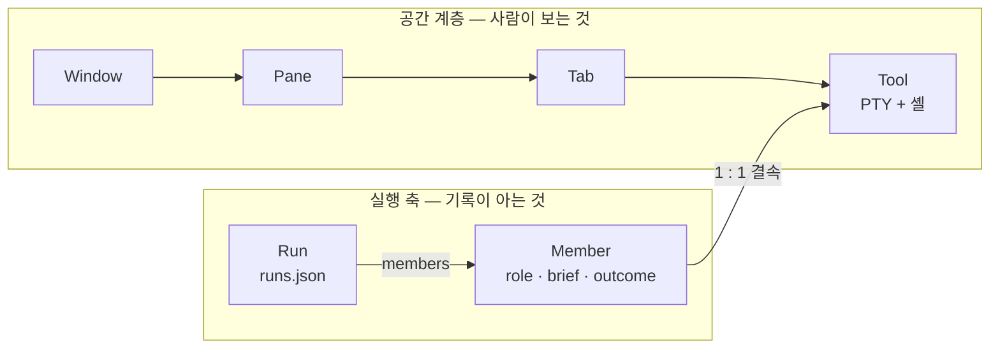
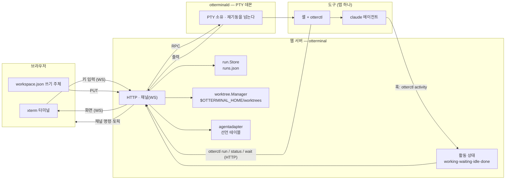
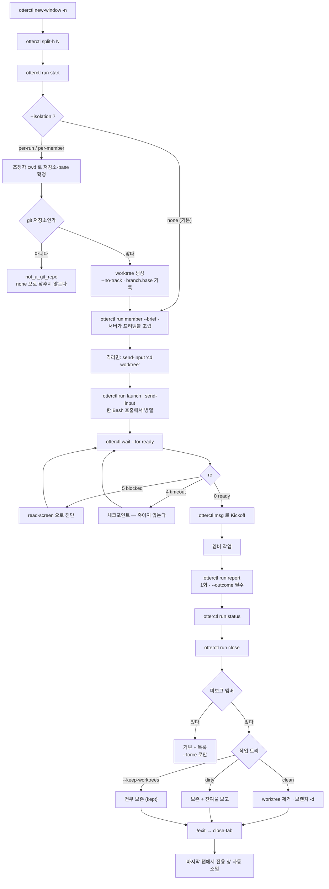
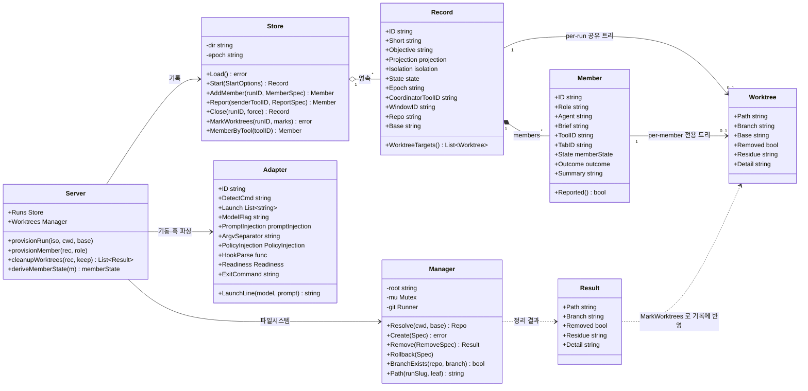
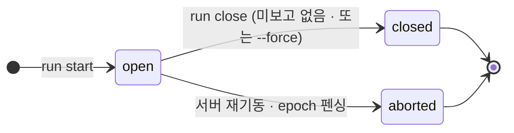
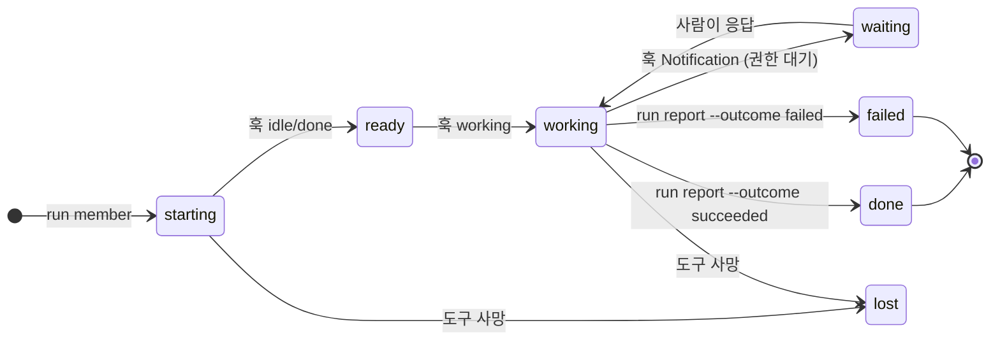

# 아키텍처

## 프로세스 역할 넷

바이너리는 하나인데 **프로세스 역할은 넷**이다. `main()` 이 argv 로 갈라진다.

```
Browser (xterm.js)                    ┌─ ② otterminald ─────────────┐
   │  WebSocket /channel              │   PTY 소유 · ToolManager    │
   ├────────────────────▶ ③ otterminal │   브라우저 새로고침에도 유지 │──▶ Shell
   │  (터미널·명령·상태)   (웹 서버)  └────────────┬───────────────┘
   └─ REST /api/* (명령) ──▶ HTTP/WebSocket        │ Unix socket
                                  │               │ (paned.sock)
                                  ↕               ↕
                          OTTERMINAL_HOME/
                            ├ settings.json
                            ├ workspace.json   (schemaVersion 2)
                            ├ tools.json
                            ├ agents.json · agents/*.jsonl   (에이전트 세션 레코드·이벤트 로그)
                            └ bin/ ──▶ ① otterctl / edit / download / detach
                                       (같은 바이너리의 multi-call symlink)

④ otterminal start|stop|health|migrate   — 제어 CLI. ③ 을 띄우고 접는다
```

데몬이 PTY 를 들고 있어서 웹 서버를 재시작해도 터미널 세션이 살아남는다. 데몬이
없으면 ③ 이 자기 프로세스에 ToolManager 를 만든다(direct mode) — 그래서
`shared/toolhub` 를 ②③ 이 함께 실행한다.

- 프론트엔드는 `rust-embed` 로 바이너리에 포함(`otter-web-assets`).
- 런타임 헬퍼(`otterctl`, `edit`, `download`, `detach`)는 multi-call CLI — `$OTTERMINAL_HOME/bin/` 에 바이너리를 가리키는 symlink 로 설치된다. zsh/bash cwd 훅은 바이너리에 번들되어 풀린다. 각 터미널의 shell 은 자동으로 이 경로를 `PATH` 에 얹고 `ZDOTDIR`(zsh)·`--rcfile`(bash) 로 훅 연결.
- PTY 프로세스는 브라우저 새로고침해도 유지 (서버 메모리 버퍼).
- 워크스페이스(창/분할 칸/탭) 는 `workspace.json` 에 비동기 영속화 (H5 latest-wins coalescing). 도구는 `tools.json` 에 기록되고(소유자 없는 백그라운드 도구·샌드박스 도구 제외), 되살릴 때 탭이 참조하는 것만 고른다(FR-EM-14). 백그라운드 도구는 기록되지 않아 데몬 재시작을 넘기지 않는다.
- 에이전트 접합면: 액션은 `otterctl` 서브커맨드, 정책은 `--plugin-dir`/`--settings` 로 세션 스코프 주입되는 스킬·훅. 등록 절차 없음. 자세히는 [docs/external/agent-orchestration.md](../external/agent-orchestration.md).
- 주의 알림: 서버가 도구 출력을 관찰(OSC 9/99/777·idle)하거나 `otterctl notify`(claude/codex 투명 래퍼가 자동 주입한 hook 이 호출)로 주의 상태를 잡아 채널(`/channel`)의 `attention` 토픽으로 브라우저에 전달. 자세히는 [docs/internal/archive/PANE_ATTENTION_NOTIFY_SRS.md](./archive/PANE_ATTENTION_NOTIFY_SRS.md).
- 에이전트 활동: attention 과 직교하는 "현재 작업 상태(activity)" 레이어. 에이전트 hook 이 `otterctl activity` 로 보고(stdin hook JSON 파싱) → `POST /api/tools/activity/set` → 채널의 `activity` 토픽으로 발행. 도구당 최신 1개 상태만 보관(히스토리 없음). 자세히는 [docs/internal/archive/AGENT_ACTIVITY_PANEL_SRS.md](./archive/AGENT_ACTIVITY_PANEL_SRS.md).

자세한 패키지 구조와 핫패스 성능 설계는 이 문서의 아래 절에 있다.

*(위 그림은 README 가 사용자 문서가 되면서 옮겨 온 것이다 — README_REWRITE_SRS
FR-RDM-10.)*

## 패키지 레이아웃

`rust/crates/` 는 **프로세스 축**으로 묶여 있다. 판정 기준은 "링크되냐"가 아니라
**"어느 프로세스가 실제로 실행하냐"** 다 — 단일 바이너리라 링크 클로저는 네 프로세스가
모두 같아서 그것으로는 아무것도 갈리지 않는다. 둘 이상이 실행하는 것만 `shared/` 다.
근거와 실측은 [PACKAGE_RESTRUCTURE_SRS.md](./PACKAGE_RESTRUCTURE_SRS.md) §2.1.

```
rust/                    # Cargo 워크스페이스 — crate 하나가 디렉터리 하나 (이름 otter-<축>-<이름>, 목록은 rust/Cargo.toml members)
  crates/
    cmd/
      otterminal/         # composition root (main) — 진입점 판별 + 의존 조립
    helper/              # ① otterctl/edit/download/detach 프로세스
      runtimebin/        #   multi-call CLI 구현 (otterctl notify·activity 포함)
      toolline/          #   otterctl 공용 한 줄 렌더러 (byte-level 동일 출력 보장)
    daemon/              # ② otterminald 프로세스 — PTY 를 소유한다
      boot/              #   데몬 진입점 (Run). 웹 서버를 재시작해도 세션이 살아남는 이유
      chat/              #   채팅 핵심 — 간선 상대마다 채팅 연결, 서명한 노드 상태·글 전파, 방·참가자. 글을 들지 않는다 (PEER_CHAT_SRS §3.9)
      chatsock/          #   채팅 소켓 chat.sock — MCP 연결 하나가 참가자 하나, 훅 질의 중계, 쉬는 중 붙여넣기 알림 (PEER_CHAT_SRS §3.10)
      ipc/               #   PanedServer — Unix socket accept 루프 (연결 하나의 요청은 차례로, create·restore·edge 만 읽기 루프 밖 — FR-OPT-2-3, PEER_DAEMON_SRS §3.5a)
      swap/              #   세션 유지 교체 — 교체 요청 검사·사전 확인·인계 상태·exec, 새 데몬의 되살리기·되찾기·입양 (DAEMON_SESSION_KEEP_SRS)
    webserver/           # ③ 웹 서버 프로세스
      httpapi/           #   HTTP·채널(WebSocket `/channel`) 라우팅 + settingsStore + 잔여 핸들러 (Server). 채널은 channel/ (perf/CHANNEL_PROTOCOL.md)
      httproute/         #   라우팅표 한 벌 — httpapi·gitapi 가 타입 매개변수로 공유
      gitapi/            #   /api/git/* 핸들러 (GitServer). 라우트 테이블(routes.rs)을 스스로 소유 — 수는 그 표가 답한다
                         #     write.rs — 쓰기 한 번의 순서를 타입이 강제한다
      apierr/            #   sentinel → (status, code) 등록부 + 와이어 코드 단일 소유
      action/            #   동작의 답 {ok, why, args} + 동작 ID → 사유 코드 목록 (SERVER_DRIVEN_ACTIONS_SRS)
      fswatch/           #   보이는 디렉터리의 비재귀 감시(fsnotify) · 이벤트 병합 · `fs_changed`
      hub/               #   CommandHub(명령 방송) · FocusRegistry · AttnTracker
      envelope/          #   방송 본문 봉투(`payload`). 채널 cmd 프레임의 본문이다
      toolclient/        #   ToolClient — 데몬에 붙는 IPC 클라 (재접속 supervisor 포함)
      recordsync/        #   에이전트 기록을 데몬에 쓰는 비동기 큐 — (kind, tool) 마다 마지막 값 (AGENT_RECORD_DAEMON_SRS)
      seam/
        adapters/        #     toolaccess 인터페이스 ↔ 구체 타입 브리지
        toolaccess/      #     도구(PTY)·워크스페이스·커맨드 허브 접합면 인터페이스
      domain/
        claudeacct/      #     Claude 다중 계정 — 계정 백업·활성 저장소 교체·OAuth API (CLAUDE_ACCOUNTS_SRS)
        git/             #     git 실행의 유일한 경로. 아래 5패키지 (§git 절)
          core/          #       Service + 두 초크포인트(Exec, ExecWrite) + guard·errors·record
          query/         #       조회 — Exec 만 쓴다
          write/         #       변경 — ExecWrite 만 쓴다
          store/         #       TTL + single-flight 캐시
          jobs/          #       원격 작업(fetch/pull/push) 잡 큐
        run/             #     Run 레코드 — runs.json + 투영/격리 타입 + 멤버 프리앰블
        worktree/        #     Run 격리의 git worktree 생성·정리 + 안전 가드
        sysstat/         #     상태바 지표를 커널에서 직접 읽는다 (OS 모듈 격리)
        submodule/       #     서브모듈 목록·조작 — 허용 목록의 판정 단위라 별도 패키지
        wsentry/         #     workspace.json 최상위 두 목록 (git.pinned[]·editors.list[])
        lsp/             #     언어 서버 세션 (정의·참조·호버) — 세션 상한·유휴 회수
        ext/             #     언어 서버 플러그인 매니페스트 — 서버 목록은 여기 없다
        telegram/        #     Telegram 브리지 — telegram.json·Bot API 클라이언트·대화별 토픽·transcript 출력 (실험)
    ctl/                 # ④ 제어 CLI 프로세스
      cli/               #   start/stop/health/migrate 디스패치 + 옵션 해석
      migrate/           #   v1 → v2 엔티티 스키마 1회성 변환
      decidx/            #   결정 색인 생성기 — `cargo run -p otter-scripts-gen-decisions` 가 부른다
      privhelper/        #   사람 명령의 도우미 `otterminal helper` — root 로 돌며 TOTP 를 확인하고 묶음에 서명한다 (PEER_CHAT_SRS §3.12)
      errdoc/            #   오류 카탈로그 생성기 — `cargo run -p otter-scripts-gen-errors` 가 부른다
                         #     (apierr 를 읽는다 — check-pkg-axis.sh 의 예외 등록부)
    shared/              # 둘 이상의 프로세스가 실행한다
      workspace/         #   ①②③ — workspace.json 인덱싱·resolve·영속화
      uuid/              #   ②③④ — 엔티티 uuid(UUID v7) 생성·파싱
      toolhub/           #   ②③  — ToolManager·PTY·브라우저 WS·주의 알림 탐지(OSC/idle)
                         #     conn(SafeConn) · tool(PTY 하나의 수명) · manager(레지스트리)
                         #     persist(tools.json) · manager_hub(ToolHub 구현) — 타입이 곧 파일
                         #     tool_{attention,clients,control,cwd,env,exitinfo} — Tool 의 관심사별 (M8 D-A-10)
      edge/              #   ②③  — 노드 간 통신(간선) — 노드 신원(인증서)·edges.json·노드 전용 리스너 (PEER_DAEMON_SRS FR-PDM-1·70)
      edgemesh/          #   ②③  — 간선 계층의 간선 연결·망 정보(net)·직접 정보(hello)·간선 초대(invite). 채팅이 그 위층이다. 데몬만 세운다 (EDGE_MESH_SRS)
      edgenode/          #   ②③  — 노드 하나의 상태와 연산(짝맞춤 판정·로컬 API 연산). 데몬과 직접 모드 서버가 같이 쓴다 (PEER_DAEMON_SRS FR-PDM-2)
      chatwire/          #   ①②③ — 채팅 소켓의 경로·프레임 (데몬 chatsock ↔ otterctl chat-mcp·ctx-hook, PEER_CHAT_SRS §3.10). 서버는 사람 참가자 IPC 의 글 모양으로 쓴다 (§3.11)
      humancmd/          #   ②④  — 사람 명령의 와이어 — 도우미 소켓 프레임, 서명한 명령 본문(Ed25519), 데몬 쪽 클라이언트 (PEER_CHAT_SRS §3.12)
      edgerelay/         #   ②③  — 노드 포트의 바이트 통로 — 서버 노드 포트 → 데몬 node.sock, 데몬 → 서버 dial.sock (PEER_DAEMON_SRS 묶음 L)
      httpreq/           #   ②③  — 요청 본문을 읽는 한 자리 (표면별 크기 상한)
      httpresp/          #   ②③  — JSON 응답·오류 응답(코드 헤더)을 쓰는 한 자리 (본문 모양은 방언 함수가 정한다)
      toolipc/           #   ②③  — paned 와이어 포맷만: wire.rs(봉투·ProtocolVersion) · protocol.rs(메서드·이벤트 이름, typed 인자·결과, hello.features) · lib.rs(데몬 지문 이름)
      outbuf/            #   ②③  — PTY 출력 바운디드 링 (Stream — 좌표는 누적 입력 바이트, FR-OPT-3-3)
      linestore/         #   ②③  — 화면 기록의 줄 저장소: 논리 줄(글자·속성·OSC 8) 블록 deflate, 절대 줄 번호, 상한·ED3 (PERF FR-TRM-2·D-14·D-28)
      runtime/           #   ②③  — helper symlink 설치 + 셸 훅 embed + agent-hooks 생성
        assets/          #     embed 하는 실제 파일
          shellhooks/    #     bash-hook.sh, zdotdir/.zshrc (실제 파일)
          agentplugin/   #     세션 스코프 주입 플러그인 (commands/issue-tree, commands/migration)
      agentrec/          #   ①②③ — 에이전트 보고의 해석·기록 값의 모양·보고 소켓 경로 (AGENT_RECORD_DAEMON_SRS §3.2a)
      agentadapter/      #   ①③  — 에이전트별 선언 테이블 (기동·탐지·주입·훅 파서·종료)
      handover/          #   ③④  — 데몬 교체(세션 유지 재시작)의 와이어 — 교체 요청·사유 코드·인계 판 (DAEMON_SESSION_KEEP_SRS)
      runfile/           #   ②③  — runs.json 읽기만 (헤드리스 도구 id). 스키마의 주인은 domain/run
      statusline/        #   ①③  — statusLine 입력의 허용 목록 한 벌 (otterctl statusline 이 채우고 서버가 같은 타입으로 받는다)
      runwait/           #   ①③  — Run 종단이 요청을 붙잡는 상한 (서버와 otterctl 이 같은 수를 읽는다, M8 D-A-1·24)
      pollwait/          #   ①③④ — "조건이 설 때까지 묻는" 대기 한 벌 (요청 경로·데몬 소켓·start/stop, M8 D-A-15)
      cadence/           #   ②③④ — 남는 주기 등록부: 깨어나는 간격 상수와 그 이유 한 벌 (PERF M4 설계 §3)
      sandbox/           #   ②③  — Window 하나의 컨테이너 생명주기 + 그 안의 실행 명세
      sandboxplace/      #   ②③  — 샌드박스 프로파일 → 실행 명세 배선 (toolhub 와 sandbox 를 잇는다)
      mimeprobe/         #   ②③  — 바이트 앞머리로 그림인지 (파일 종단·git 블롭 종단이 같은 한 벌, M9 FR-M9-21)
      diagtail/          #   ②③  — 실행 진단 문자열의 절단 규칙 하나 (상한은 표면마다)
      termlimit/         #   ②③  — 데몬 터미널의 메모리 예산 상수 한 벌: 에뮬레이터 keep·상한, 유휴 비우기 시간, 기록 줄 수 기본·범위, 저장소 블록, 출력 링 (PERF NFR-PRF-10, D-54)
      termstate/         #   ②③  — 도구마다 한 벌의 화면 상태. alacritty_terminal(=0.26.0)을 이 crate 에만 가둔다 (PERF SRS FR-TRM-1·7, D-13)
      termtext/          #   ①②③ — 화면·터미널에 찍을 글자의 규칙 한 벌: 숨은 글자(제어·Cf) 판정·정화, 지문 줄이기 (REFACTOR3_DEDUP_GO_SRS FR-RDG-43·44)
      textenc/           #   ③   — 텍스트 인코딩 판별·엄격 디코드·재인코딩 (파일 종단·git diff 가 같은 한 벌, REPO_FIX 03)
      editorlimit/       #   ③④  — 편집기가 여는 한 파일의 상한 32 MiB (읽기·저장·LSP·git diff·verify 가 같은 한 벌, D-OPT-9)
      serverconf/        #   ③④  — 서버 기동값 네 계층 (플래그 > 환경 > server.json > 기본)
      release/           #   ①③  — 최신 릴리스가 무엇인가 하나만 (update --check 와 서버 확인이 같은 판정)
      updatecheck/       #   ③   — 최신 판 캐시 한 칸 + 트리거 넷 (끈 것은 실제로 나가지 않는다)
      settingsschema/    #   ③④  — settings-schema.js 를 같은 바이트로 읽는다 (표는 JS 가 원천)
      listorder/         #   ③   — 끌어다 놓기 한 번의 목록 반영 (gitapi·wsentry 가 공유)
      fanout/            #   ③   — 상한 있는 병렬 반복 한 벌 (핀 관측·핀 목록·git 감시 회차가 공유, FR-OPT-7-4)
      platform/          #   ①②③④ — OS 마다 갈리는 능력을 인터페이스 뒤로 (경로·프로세스·셸·소켓)
      otterenv/             #   ①②③④ — 환경변수 이름·기본 엔드포인트·헬퍼 이름·홈 아래 이름 (의존 0)
      apipath/           #   ①④  — 서버 로컬 API 경로 한 벌 (otterctl·헬퍼·제어 CLI 가 부르는 이름, 서버 라우트와의 일치는 시험이 대조, REFACTOR3_GO_STRUCT_SRS FR-RGS-40)
      activity/          #   ①②③ — 에이전트 활동 상태의 어휘 다섯 (JS 짝은 constants.js, FR-OPT-10-1)
      otterlog/             #   ①②③④ — 로그가 지나는 한 자리 (수준·요청 ID)
      testpath/          #   테스트 전용 — OS 마다 다른 경로 전제를 분기 없이 다룬다 (+ 셸 고정 PinShell, M8 D-A-21)
      gittest/           #   테스트 전용 — git 저장소 픽스처 한 벌 (M8 D-A-20). 제품 코드는 import 하지 않는다
    gocompat/            # 축 밖 — Go 기준선의 출력 규칙 (JSON·시간·인용·OS 오류 문구). 어느 축이든 쓴다
    web/                 # 축 밖 — web/ 자산을 바이너리에 싣는다 (otter-web-assets)
    scripts/             # 축 밖 — 게이트·생성기 프로그램 (`cargo run -p otter-scripts-<이름>`)
      check-action-reasons/
      check-shared-constants/
      gen-decisions/
      gen-errors/
web/                     # 프론트엔드 자산 + embed.FS()
  bundles.txt            # 묶음 정의 (PERF D-29) — [이름] 아래 .js·.css 순서 = 로드 순서. 서버가 /b/<이름>.js·.css 로 낸다
  style*.css             # <link> 순서 = 캐스케이드 순서. 부팅 CSS: grep 'rel="stylesheet"' web/index.html · 화면 CSS: bundles.txt
  js/core/               #   App 클래스 (app.js + 주제별 컨트롤러 *-controller.js 와 그 부품 — 수: ls web/js/core/*-controller.js | wc -l) + helpers·main
                         #     base/ — Component·View·Controller 기반 클래스 (REFACTOR3_FE_BASE_SRS)
                         #     constants*.js — 주제별 상수 (로드 순서 = web/bundles.txt 의 순서. 목록: ls web/js/core/constants*.js)
  js/ui/                 #   themes·renderer·term-pane·clipboard·file-editor 등
                         #     file-tree{,-store,-obs,-load,-select,-paint,-keys,-marquee,-edit,-xfer,-download}.js — 탐색기
  js/git/                #   git 패널. api.js — gitFetch/gitPost (stale·echo 가드 소유)
                         #     observer(관측 하나) · panel(칸마다 하나) · diff-view(CodeMirror merge)
                         #     git-{poll,changes,views,write,files,selection,…}.js — GitPanel 의 부품 (GitPart 하위, 목록은 panel.js 머리 주석)
                         #     status-hub.js — GitStatusHub: root 별 status 한 벌 (탐색기·dirty-diff 공유, FR-OPT-4-1)
e2e/                     # Playwright 스펙 + git 픽스처(git_fixture.sh)
scripts/                 # build.sh — 빌드 · verify-isolated.sh — `otterminal verify` 껍데기 · check-*.sh — 게이트
                         #   check-*.sh 중 넷은 rust/crates/scripts/ 의 프로그램을 cargo run 으로 부른다:
                         #   gen-decisions(decisions.md) · gen-errors(errors.md) · check-action-reasons · check-shared-constants
.github/workflows/       # verify.yml — 매 푸시 검사 (Linux·Windows)
                         # release.yml — 태그 v* → 5개 대상 빌드 → GitHub Releases
                         #   운영 동작은 바이너리의 액션 (rust/crates/ctl/cli)
docs/
  internal/              # 개발자 문서 (이 파일)
  external/              # 사용자 문서
```

**모든 crate 가 네 프로세스 중 하나 또는 `shared/` 에 속한다.** 마지막까지 축 밖에
있던 Go 기준선(main)의 `internal/server` 가 `httpapi`(지금 `rust/crates/webserver/httpapi`)로 들어오면서 그렇게 됐다. 판정
기준은 링크 클로저가 아니라 **실행**이다 — 단일 바이너리라 클로저는 네 프로세스가
모두 같고, 그것으로는 아무것도 갈리지 않는다.

**축의 import 규칙은 게이트가 지킨다** (`scripts/check-pkg-axis.sh`, M8 `GO-4`): 축
crate 는 자기 축과 `shared/` 만, `shared/` 는 `shared/` 만 의존한다 (`cargo metadata` 의
경로 의존, 추이 의존 포함, dev-dependencies 제외. 축 밖의 `gocompat`·`web` 은 어느 축이든 쓴다).
위 표도 같은 게이트가 워크스페이스 crate 와 양방향으로 대조한다 (`GO-48`).
**예외는 그 스크립트의 `ALLOW` 에만 있다** — 직접 의존 한 쌍 단위로 근거와 함께.
지금은 둘이다: `ctl/cli → domain/git/core`(git 실행과 URL 마스킹의 유일한 규칙을 ④ 가
우회하지 않는다) · `ctl/errdoc → apierr`(생성기의 원천). 종전 문서는 "예외는 없다" 고
적었으나 감사(`01-go-arch.md`) 시점에 네 곳이 새어 있었다 — 규약은 선언으로 지켜지지
않는다.

`httpapi` 안의 핸들러는 **무엇을 손볼 때 함께 봐야 하는가**로 갈라 뒀다.
`files.rs` 가 경로를 사용자 입력에서 받는 유일한 면의 가드이고(`safe_resolve`·
`unique_path` 가 여기 있다 — 종단은 `files_{transfer,stamp,rw}.rs`), `attention.rs` 는 같은 `AttnTracker` 상태를 읽는
종단 8개, `settings.rs` 는 서버가 해석하지 않는 JSON blob 이다(모두 `rust/crates/webserver/httpapi/src/`).
라우트 테이블(`API_ROUTES`)은 `routes.rs`, 디스패처(`handle_api`)는 `serve.rs` 에 있고, 아직
제 파일로 나가지 않은 종단 — `/api/state`·도구 생성·busy(단건·일괄)·삭제·workspace
GET/PUT·ping·stats·sandbox 다섯 — 과 `reapSandboxes` 가 있다. 채널이 다시 열릴 때(`chan:open`)의
복원은 `snapshot.rs`(`GET /api/snapshot`, FR-OPT-4-5)다.

**프론트엔드는 번들러가 없다.** 서버가 `web/bundles.txt` 의 순서대로 원본을 이어 붙여 묶음
`/b/<이름>.js`(파일 사이 `/* ==== <경로> ==== */` 경계, 주석·줄 끝 공백을 걷되 줄 수는 그대로, 줄 단위 소스맵
`/b/<이름>.js.map`)로 내고, `index.html` 이 vendor → `b/pre.js` → 활성 언어 파일 하나 → `b/boot.js` 를 클래식
`<script>` 로 싣는다(PERF D-29·D-34·D-42, `httpapi/src/bundles.rs`). 화면 묶음(git·편집기·문서 렌더·Run·채팅·설정)과
그 CSS 는 처음 열 때 `Screens.load` 가 싣는다(`core/screens.js`, D-30). 그래서 **로드 순서가 곧 의존성**이다.
부팅 코드가 화면 묶음의 전역을 읽지 않는 것은 `scripts/check-lazy-boundary.mjs` 가 지킨다. 기반 클래스(`core/base/` 의 `Component`·`View`·`Controller`)가
맨 앞이고, `app.js` 뒤에 주제별 컨트롤러가, 맨 끝에 `main.js` 가 온다.

**`App` 의 주제별 일은 컨트롤러가 맡는다** (`REFACTOR3_FE_APPCTL_SRS`). 컨트롤러는
`Controller` 하위(`*-controller.js`)이고 App 은 그것을 필드로 든다(`app.layout`·`app.tool`·
`app.git` 등). 컨트롤러가 크면 부품으로 다시 나눈다(`app.layout.tabOps`·`app.tool.cmd` 등).
바깥은 컨트롤러의 이름을 **소유 경로**로 부른다(`app.slot.slotFocused()`·`app.editor.open.edOpenFile()`) —
App 원형에 위임자를 두지 않는다(`REFACTOR3_FE_DELEG_SRS`, 게이트 `scripts/check-delegates.mjs`). 컨트롤러 안에서
자기 이름은 `this.X()` 다. 시험·e2e 는 소유 인스턴스의 메서드를 갈아 끼운다. 이름을 문자열로 드는 표(상태 등록부·
편집기 키·설정창 세우기 순서)와 e2e 계약 `app-testing.js` 는 앱에서 주인까지의 점 경로(`'git.sync._onGitChanged'`)를
들고 부를 때 푼다. 지연 생성 본체는 `app.lspClient()`·`app.runsPanel()` 로 부른다. 옛 `app-*.js`
(`Object.assign(App.prototype, …)` 로 원형을 넓히던 mixin)는 남아 있지 않다.

**`GitPanel` 도 부품으로 나뉘었다** (`REFACTOR3_FE_GITPANEL_SRS`). 부품은 `GitPart` 하위이고
패널이 필드로 든다(`this.poll`·`this.changes`·`this.views` 등 — 목록은 `git/panel.js` 머리 주석).
본체에는 생성자·접근자·리포 전환과 수명만 있다. 바깥은 `panel.<부품>.X`, 부품 안의 자기 이름은 `this.X`, 다른 부품은
`this.p.<부품>.X` 로 부른다 — 패널에 위임자를 두지 않는다(`REFACTOR3_FE_DELEG_SRS`). 접근자가 본체에 있는 이유는
`Object.assign` 이 getter 를 값으로 복사하기 때문이다 — 접근자는 값이 아니라 **자리**를 빌려 온다.

**`FileTree` 도 부품으로 나뉘었다** (`REFACTOR3_FE_REST5_SRS` R5d — 종전에는 주제별 파일이
`Object.assign(FileTree.prototype, …)` 로 얹었다, `SPLIT_REFACTOR_SRS`). 부품 여덟 — 조회·git 색(`FileTreeLoad`) ·
선택·클릭·펼침(`FileTreeSelect`) · 항목·그리기(`FileTreePaint`) · 키(`FileTreeKeys`) · 사각형 선택(`FileTreeMarquee`) ·
생성·이름 변경·삭제(`FileTreeEdit`) · 업로드·우클릭·끌어 놓기(`FileTreeXfer`) · 다운로드(`FileTreeDownload`) — 을 생성자가
만들어 든다(`this.loader`·`this.painter` 등, 목록은 `ui/file-tree.js` 머리 주석). **상태는 인스턴스에 남는다** — 부품은
`this.tree` 로 읽고 쓴다. 부품의 이름은 탐색기 원형에 없다 — 앱·렌더러·e2e·시험은 `tree.loader.reload()` 처럼
부품을 부르고 부품 인스턴스를 갈아 끼운다. 부품 안의 자기 이름은 `this.X`, 다른 부품은 `this.tree.<부품>.X` 다
(`REFACTOR3_FE_DELEG_SRS`). `FileTreeStore` 로 가는 통로인
접근자와 정적 넷(`FileTree._asUploadItems` 등)은 클래스 본문에 있다.

**CSS 도 같은 문제를 다르게 푼다.** `style.css` 는 여럿으로 갈렸고 `<link>` 순서가
원본의 선언 순서다 — 캐스케이드는 순서가 곧 의미라서, 파일을 옮기는 것과 순서를
바꾸는 것을 구별해야 한다. 그래서 편집기 엔진 규칙은 `style-editor.css` 가 아니라
`style.css` 쪽에 남아 있다 — 지금은 `style.css` 를 원래 순서의 연속 구간으로 나눈 조각 `style-system.css` 다
(REFACTOR3_FE_REST4_SRS FU-11). 500줄을 넘던 넷(`style-kit`·`style-git`·`style-git-views`·`style-editor`)도
같은 방법으로 바로 뒤에 실리는 조각 하나씩을 얻었다(`-controls`·`-commit`·`-tabs`·`-tools`, REFACTOR3_FE_REST5_SRS FR-FR5-1).

## 오류 응답 — 판정은 한 곳, 렌더링은 표면마다

이 서버에는 오류 본문 **방언이 넷** 있고 각각이 브라우저가 소비하는 공개 계약이다:

| 방언 | 본문 | 쓰는 곳 |
|---|---|---|
| git | `{"error": <코드>, "message": <tail>}` | `/api/git/*` |
| fs | `{"code": <코드>, "message": <msg>}` | `/api/fs/*` · `/api/editors/*` · 노드 포트의 `/edge/v1/*` · `/api/edges/*` |
| runs | `{"error": <sentinel 문자열>, "detail": <err>}` | `/api/runs/*` |
| 단문 | `{"error": <msg>}` | `/api/tools/{output,input,message}` · `/api/whoami` |
| 평문 | `text/plain` 한 줄 | 그 밖의 `/api/*` (`http_err`) |

> **표가 넷을 세는 동안 실물은 다섯이었다** (2026-09-12, M5 `G6-1`).
> Go 기준선(main)의 `http.Error` 가 쓰던 `text/plain` 이 다섯 번째 방언이고 65곳이 그것을 냈다.
> 지우는 것이 아니라 **세는 것이 먼저다** — 세지 않은 방언은 통일 논의에서도 빠진다.

**통일하지 않는다** — 그것은 리팩터가 아니라 파괴적 변경이다. 대신
`rust/crates/webserver/apierr` 가 **매핑과 어휘**를 소유하고 렌더링은 각 표면에 남는다
(DEEPENING_REFACTOR_SRS 묶음 A). 성공 JSON 은 모양이 하나라 `otter_shared_httpresp::json` 한 자리가
쓴다 (OPTIMIZE_REFACTOR_SRS FR-OPT-9-4) — 이 결정은 오류 본문의 것이고, 성공 응답의
헤더·인코딩을 모으는 것은 그 밖이다.

**코드는 방언 밖으로도 나간다** (M5 `G6-1`, `ERROR_CONTRACT_SRS`). 모든 오류 응답이
`X-Error-Code` 헤더에 코드를 싣는다 — **본문은 한 바이트도 바뀌지 않는다.** 본문이
공개 계약이고 헤더는 그 밖이라, 통일을 미루면서 코드를 얻는 유일한 길이다.
카탈로그는 `docs/external/errors.md` 이며 `rust/crates/webserver/apierr/src/codes.rs` 의 `CODE_DOC` 에서 **생성**된다.

**헤더를 세우는 문은 하나다** (REFACTOR3_DEDUP_GO_SRS FR-RDG-1·2). 헤더 이름은
`httpresp::CODE_HEADER` 하나이고(`apierr` 는 그 값을 가리킨다), 모든 방언 함수는
본문만 만들어 `httpresp::fail` 에 넘긴다 — 그 함수가 코드 헤더를 세우고 상태와 본문을 쓴다.
`{code,message}` 방언은 `httpresp::fail_code` 하나다. `shared/edge`·`edgenode` 는
`webserver` 를 가져올 수 없어 이 자리가 `shared` 에 있다. 요청 본문의 JSON 읽기는
`httpreq::decode_json` 하나가 하고 실패 종류만 돌려준다 — 답은 방언이 한다.

```
domain sentinel 78개 ──▶ apierr.{Git,Runs,FS}.Lookup ──▶ (status, code)
                                                            │
                     각 표면의 렌더러가 자기 본문 모양으로 싣는다
```

**테이블이 표면마다 하나인 이유** 는 같은 sentinel 의 옳은 상태 코드가 표면마다
다르기 때문이다:

```
worktree.ErrNotRepo → /api/git/worktrees  404  (지목한 것이 거기 없다)
                    → /api/runs           400  (호출자가 인자로 준 것이 틀렸다)
```

기계(`apierr::Table::lookup`)는 공유하고 정책(테이블)은 표면이 갖는다.

**전수성이 강제된다.** `apierr/src/inventory.rs` 가 HTTP 에 도달할 수 있는 sentinel
전부를 열거하고, 테스트가 "규칙이 있거나 사유와 함께 면제됐다"를 검사한다. 새
sentinel 을 더하고 둘 중 아무것도 하지 않으면 실패한다 — **조용히 500 이 되는
경로가 구조적으로 없다.**

## git 쓰기의 순서는 타입이 쥔다 (`rust/crates/webserver/gitapi/src/write.rs`)

쓰기 핸들러는 `GitWrite` 를 지난다. 실패가 **끈적해서**(sticky) 한 번 응답한 뒤의
모든 단계가 무동작이므로, 핸들러에 `if !ok { return }` 이 없다:

```go
var req gitDiscardReq
t := s.beginWrite(w, r, &req)          // Git nil 검사 + 본문 디코드
t.requireConfirm(true, req.Confirm, …) // FR-GIT-89
t.resolve(req.Repo)                    // FR-GIT-62
t.apply(func(ctx context.Context) error { … })  // 실행 전 status 를 스스로 찍는다
t.ok(nil)                              // 실행 후 status 를 함께 싣는다 (FR-GIT-71)
```

`snapshot()` 은 멱등이고 `apply` 가 부르지 않았으면 스스로 부른다 — **"실행 전
status 를 빼먹는" 경로가 없어야** 부분 적용 판정(FR-GIT-73)이 성립한다.

표준형에 맞지 않는 것은 **억지로 넣지 않는다.** 응답에 오류값 밖의 데이터를
실어야 하는 자리(부모 목록·stash 잔존·Publish 계획·preflight 전문)는 제자리에
남았고, 그 목록과 사유는 SRS §7.2 에 있다.

## 프론트엔드 git 조회 (`web/js/git/api.js`)

서버가 응답마다 `requested` 를 되싣는 이유는 하나다 — 늦게 온 남의 응답을 자기
것으로 읽지 않는 것(FR-GIT-16). 그 **echo 검증**을 `gitFetch` 가 소유한다:

```js
const res = await gitFetch('/api/git/stash', {repo},
  {stale: () => this.panel.isStale(tok), echo: {repo}});
if (res.stale) return;          // 조용히 나간다 — 남의 응답이다
if (!res.ok)   { …사유를 보이고 이미 받은 목록은 지우지 않는다… }
```

반환값이 셋(성공·stale·실패)인 이유는 호출자가 셋에 **다르게** 반응하기
때문이다. null 하나로 접으면 stale 이 실패로 보이고, 리포를 빨리 바꿀 때마다
오류가 번쩍인다.

`requested` 의 모양이 종단마다 문자열/객체 둘이라 `gitEchoOk` 가 둘 다 받는다.
**`d.repo` 로 비교하지 않는다** — 그것은 서버가 정규화한 루트라 보낸 값과 다를 수
있고, 그것으로 짝을 맞추면 목록이 영원히 실패로 남는다.

캡슐화는 crate 경계가 강제한다 — 한 crate 의 비공개 항목(`pub(crate)` 이하)은 다른 crate 가 쓸 수 없고, crate 사이의 의존은 축 규칙(`scripts/check-pkg-axis.sh`)이 지킨다. 웹 자산은 `rust/crates/web`(`otter-web-assets`)이 `web/` 을 싣는다.

## 런타임 헬퍼 배포 (`rust/crates/shared/runtime`)

`otter_shared_runtime::install(bin_dir)` 이 서버 기동 때 `$OTTERMINAL_HOME/bin/` 을 채운다.

**helper CLI** 는 `rust/crates/helper/runtimebin` 의 multi-call dispatch 로 otterminal 바이너리 자체가 처리하므로, `bin/<name>` 은 실행 파일을 가리키는 symlink (미지원 환경에선 복사) 다. `otterenv::helper_names()` 가 단일 소스:

- `otterctl` — `/api/commands` 로 워크스페이스 action 브로드캐스트 + `list-workspace`/`who-am-i`/`notify`/`activity` + 에이전트 접합면(`read-screen`/`send-input`/`msg`/`status`/`wait`/`run`). 아래 "에이전트 접합면과 Run" 절.
- `edit` — `POST /api/commands` 로 `openEditorTab` 브로드캐스트 (내장 편집기 탭).
- `download` — OSC 777 `Download;<abs>` 출력.
- `detach` — 현재 도구를 백그라운드로 보내고 탭을 닫는다 (`--list` / `--restore <id>`).

**셸 훅** 은 shell 문법이 필수라 임베드 파일을 그대로 풀어둔다:

- `bash-hook.sh` — `PROMPT_COMMAND` 에 `_rt_cwd_hook` 주입, OSC 777 `Cwd;<pwd>`.
- `zdotdir/.zshrc` — zsh 용 `precmd`/`chpwd` 훅. `~/.zshrc` 를 먼저 source.

**agent-hooks** — 런타임 설치가 `bin/agent-hooks/` 에 Claude Code hooks settings 를 생성한다. hook 커맨드는 `otterctl` 을 절대경로로 참조해, PATH 앞쪽의 낡은 `otterctl` 이 `notify` 를 모르는 사고를 막는다.

도구 스폰 시 도구 시작 함수가 환경을 덧붙인다 (`rust/crates/shared/toolhub/src/tool.rs`):

```
PATH=<기존>:$OTTERMINAL_HOME/bin
zsh  → ZDOTDIR=$OTTERMINAL_HOME/bin/zdotdir
bash → --rcfile $OTTERMINAL_HOME/bin/bash-hook.sh   (HOST_PARITY_SRS FR-HPR-7)
TERM=xterm-256color, COLORTERM=truecolor, LANG/LC_ALL/LC_CTYPE=en_US.UTF-8
OTTERMINAL_PORT=<서버 포트>   # main() 이 setenv, 자식 PTY 가 상속
OTTERMINAL_TOOL_ID=<도구 id>  # detach 가 자기 도구를 식별하는 근거
```

## 편집기 — 저장소 탭의 행과 Editor 창 (`EDITOR_TAB_SRS` · `REPO_TAB_UNIFY_SRS`)

**편집기는 일반 창에 열리지 않는다.** 경로마다 하나씩 서는 **Editor 창**에만 산다
(FR-EDT-94). 그 창은 좌측에 파일 탐색기를, 우측에 편집기 영역을 갖는다.

```
목록 패널 탭:  창(windows) · 저장소(repo) · 채팅(chat)
저장소 탭:    [일반 행들 …] ── 구분선 ── [root 행 `~` · 메모장]   ← 최하단 고정, 삭제 불가
행 하나  =  창 하나 (`WINDOW_TYPE_EDITOR`, `editor.root`)
```

**행과 창은 재조정(reconcile)으로 맞춘다** (FR-EDT-42). 있어야 할 루트 집합은
`[home, ...editors.list]` 이고, 재조정은 **멱등**이며 같은 루트의 창이 둘이면 id
사전순으로 하나만 남긴다. 창을 만드는 주체가 브라우저인데 목록 변경은 채널로 모든
브라우저에 도달하므로, 결정론적 중복 제거가 단일 실행자 지명
(`cmdActions` 의 `single`)의 자리를 대신한다.

**`layout` 이 없는 Editor 창은 살아남는다.** 로드·채널 동기화의 창 필터가
`s.layout || isEditorWin(s) || isChatWin(s)` 다 (`layout-window-state.js`). 갓 만든 Editor 창은
탐색기만 있고 pane 이 **없는** 것이 정상 상태이기 때문이다 (FR-EDT-55).

**분할은 드래그드롭뿐이다** (FR-EDT-50·51). 단축키·버튼 분할이 없으므로 빈 pane 이
생길 경로가 없고, pane 은 언제나 탭을 하나 이상 갖는다. 탭은 **같은 Editor 창
안에서만** 옮겨진다 — 게이트는 창 경계를 넘는 두 자리(`layout-dnd.js` 의
`moveTabToWindow` 출발·도착)에만 있다. 창 **안**의 이동(`moveTabToPane`)과 드롭
분할(`splitPaneWithTab`)에 조건을 더하면 유일한 분할 수단이 함께 막힌다.

**Git 핀과 Editor 행은 서로를 만들고 지운다** (FR-EDT-31~38a). 그 연동은
`rust/crates/webserver/domain/wsentry` 가 **한 번의 read-modify-write** 로 수행한다 —
두 목록이 따로 저장되면 그 사이에 다른 브라우저가 절반만 반영된 상태를 본다. 홈은
네 방향 모두에서 무동작이다(root 행이 이미 그 경로를 대표한다). 규칙 넷은 순수
함수이며 서로를 호출하지 않는다 — AST 검사가 그것을 강제한다.

**파일 라우팅.** `edit <path>` 는 그 경로를 루트 아래에 포함하는 창(둘 이상이면 가장
깊은 것), 없으면 root 에디터로 간다. Git 의 `Open File` 은 **파일이 아니라 활성 리포
경로**로 창을 고른다 — `Open File (HEAD)` 의 임시 파일은 저장소 밖에 있어 파일로
고르면 틀린다.

### 서버 표면

| 종단 | 쓰임 |
|---|---|
| `GET /api/file/read?path=<abs>` · `POST /api/file/write` | 편집기의 파일 I/O (기존) |
| `GET /api/fs/list?root=&path=` | 탐색기 한 겹 조회. dot 항목 포함 전량, 정렬은 서버가 한다 |
| `POST /api/fs/{create,rename,delete}` | 파일 조작. **`root` 를 함께 받아 그 아래로 제한한다** |
| `GET /api/editors` · `POST /api/editors/{add,remove,reorder}` | Editor 목록. 응답에 `pinned` 를 함께 싣는다 |

조작 종단이 `root` 를 요구하는 이유는 기존 `/api/file/*` 의 가드가
`safe_resolve("/", …)` 라 **사실상 무제한**이기 때문이다. 읽기·쓰기는 사용자가 경로를
지목한 것이지만 조작은 트리 탐색에서 파생된 경로를 지운다. 그리고 루트 경계 판정에
`safe_resolve` 를 **재사용하지 않는다** — 그쪽은 `..` 접두 문자열로 판정해 `..b`·`...`
같은 정상 이름을 이탈로 오인한다.

도구의 capability 맵(`web/js/core/helpers.js` 의 `TOOL_CAPABILITIES`)은 `terminal`·`editor`·`git` 셋을 싣고, 탭 타입은 여기에 `run` 을 더해 넷이다. `backgroundCapable` 은 `terminal` 만 참이므로 나머지는 detach 대상이 아니다 (FR-BG-11).

과거의 code-server 통합(Go 기준선(main)의 `internal/server/codeserver.go`, `/cs/<id>/` 리버스 프록시, `CodeServerManager`)은 `8dc0a3f` 에서 이 내장 편집기로 대체되며 제거됐다.

## 창 슬롯 (`web/js/core/slots-controller.js`·`slot-ops.js`, `WINDOW_SLOTS_SRS`)

콘텐츠 영역(`#area`)은 창을 하나만 그렸다. Git 창과 Editor 창은 별개의 **창**이므로
(`WINDOW_TYPE_GIT`·`WINDOW_TYPE_EDITOR`) 터미널과 나란히 놓을 방법이 없었고, 그래서
사용자는 브라우저 창을 두 개 띄웠다. 슬롯은 그 일을 브라우저 창 하나 안에서 한다.

칸은 **한 줄로 나열**되며 `SLOT_MAX`(4) 까지 늘어난다. 칸 안을 다시 칸으로 쪼개지
않는다 — 그것은 창 안 분할이 이미 하는 일이다.

**창 타입의 불변식은 하나도 건드리지 않는다.** Git 창은 여전히 탭을 더할 수 없고
Editor 창에는 여전히 편집기 탭만 산다.

다만 칸은 그릇에서 **시선**이 되었다 (`SLOT_VIEW_STATE_SRS`). 창도 하나, 관측도
하나인데 **보는 자리마다 자기 시선을 갖는다** — 칸마다 다른 탭을 볼 수 있다
(FR-SVS-1). 그 규약의 원본은 터미널이다: PTY 는 서버에 하나이고 xterm 인스턴스는
칸마다 하나다 (`mkTool(toolId,name,slot)`). 활성 탭도 같은 모양이 되었다.

탐색기도 같은 모양으로 갈렸다. `FileTreeStore`(`file-tree.js`) 가 **루트마다 하나**로
디렉터리 캐시·git 색·무시된 이름을 들고, `FileTree` 는 **칸마다 하나**로 펼침·선택·
스크롤을 갖는다. 칸이 넷이어도 `/api/fs/list`·`/api/git/status` 는 한 벌만 나가고
(status 는 `GitStatusHub`(`git/status-hub.js`)가 root 별 single-flight·짧은 TTL·`ifMark`
조건부 물음으로 탐색기·dirty-diff 에 나눠 준다, FR-OPT-4-1·4-7),
관측이 갱신되면 `paintAll` 이 그 루트를 보는 칸 전부를 칠한다. store 는 뷰가 무엇을
그리는지 모른다 — "다시 칠하라" 만 말한다.

Git 도 같다. `GitObserver`(`git/observer.js`) 가 **앱에 하나**로 `status`·소실·
실패 누적과 실패 뒤 재시도를 들고(변화 신호는 채널의 `git:<root>` 토픽이 준다 — 주기로 묻지 않는다), `GitPanel` 은 **칸마다 하나**로 선택·접힘·미리보기·diff 대상을
갖는다. 그래서 왼쪽 칸에서 파일 A 의 diff, 오른쪽 칸에서 파일 B 의 diff 를 나란히
볼 수 있으면서 `git status` 요청은 한 벌이다. 하위 뷰 모듈 일곱(`history`·`branches`·
`stash`·`console`·`worktrees`·`commit`·`remote`)은 `constructor(panel)` 로 패널을
주입받는 구조라 **한 줄도 바뀌지 않았다** — 패널이 칸마다 서는 것만으로 그것들의
상태가 칸의 것이 된다. `app.gitPanel` 은 포커스 칸의 패널을 돌려주는 접근자이고,
메뉴·확인창·다이얼로그가 그것을 딛는다.

편집기는 한 겹 더 있다. **문서**(내용과 dirty)는 파일 경로마다 하나이고
(`app.edDoc`), `FileEditor` 는 칸마다 하나다. 두 에디터가 같은 버퍼
(`EdBuffer`)에 붙으므로 한 칸의 타이핑이 다른 칸에 즉시 보이고, 커서·스크롤·접힘·실행 취소는
에디터별로 남는다 (CODEMIRROR_MIGRATION_SRS §3.3). 이 층이 없던 동안 같은 파일을 두 칸에 열면 독립 편집기 둘이 각자
편집하고 한쪽 저장이 다른 쪽 저장을 덮었다.

활성 탭을 읽는 자리는 `paneTab(pn,slot)` 하나, 쓰는 자리는 `paneTabSet(pn,tid,slot)`
하나다 (`slots-controller.js`). `pn.activeTab` 을 직접 읽거나 쓰면 그 자리만 칸을 모르는
채로 남고, 어긋남은 두 칸이 같은 창을 볼 때만 드러난다. 오버라이드가 없는 pane 은
`pn.activeTab` 을 따르므로 **단일 슬롯 모드의 동작은 이전과 완전히 같다**.

포커스 칸의 시선은 `pn.activeTab` 에도 쓴다 (FR-SVS-14). `otterctl` 의 활성 판정이
`activeWindow + focusedPane + activeTab` 삼중 조건이므로 (`rust/crates/shared/workspace/src/parse.rs`), 그것이
"포커스 칸이 보는 것" 으로 유지되어야 한다 — `focusedPane` 이 로컬이면서
워크스페이스에도 쓰이는 것과 같은 취급이다.

세 가지가 이 설계를 지탱한다.

**1. 칸은 flex 아이템이고, 그 안의 `.slot-body` 가 분할 트리의 조상이다.** 트리 CSS 가
전부 `inset:0` 기반이므로 (`style.css`), `.slot-body` 가 `position:relative` 이면 트리는
그 상자를 채운다 — 트리 CSS 는 한 줄도 바뀌지 않는다. 크기는 칸마다의 **flex
배분값**(`slots.sizes`)이며, 개수가 늘어도 누적 좌표를 계산할 일이 없다. 방향은
`#area[data-slotdir]` 의 `flex-direction` 한 줄이 정한다.

**칸이 1개일 때는 컨테이너를 아예 만들지 않는다** (D-4). `#area .pn` 을 딛는 e2e 가
그대로 서 있어야 하기 때문이다.

**2. 칸마다 다른 `clientId` 를 쓴다** (FR-WSL-10, D-3). 서버는 창 하나에 소유자
하나를 두고 (`rust/crates/webserver/hub/src/focus.rs` 의 `FocusRegistry`), 한 클라이언트는 창 하나만 소유한다 (FR-XDF-3). 슬롯
둘을 한 클라이언트로 다루면 이 규칙에 먼저 걸려 한 칸이 반드시 흐려진다. 슬롯을
**서버에게 별개 클라이언트로 보이게** 하면 서버는 무변경이고, 기존 소유권 e2e 도
개정 없이 통과한다. 슬롯 1 의 신원은 탭의 채널 하나가 `hello.slots` 로 함께 밝히며, 그 채널이
소유권의 수명이다 (FR-XDF-9, `perf/CHANNEL_PROTOCOL.md` §4.1).

같은 창이 두 슬롯에 있으면 **포커스 슬롯만** 주장한다. 둘 다 주장하면 fire-and-forget
POST 두 개가 경합해 승자가 네트워크 순서로 정해진다 — 실측으로 드러난 결함이다.

**3. 슬롯 사이 이동에 새 키를 만들지 않았다.** `paneNavigate` 는 갈 칸이 없으면 조용히
끝나는 함수였고(`layout-tab-ops.js` 의 `paneNavigate`), 그 **세 탈출 지점 모두**가 이제 슬롯 경계 넘침으로
흐른다. 특히 `path.length<2` — 분할이 없는 창(Git 창)이 타는 자리다. 여기를 빠뜨리면
터미널 창에서는 넘어가는데 Git 창에서는 안 넘어간다.

| 무엇이 | 어디에 |
|---|---|
| 칸 배치(어느 칸에 어떤 창)·배분값·포커스 칸 | `sessionStorage.slots` — 브라우저 탭별 |
| 슬롯 방향(가로·세로) | `localStorage.slotDir` — 기기별 설정 |
| `workspace.json` | **무변경.** `schemaVersion` 은 2 그대로다 |

배치가 탭별인 것은 의도다 — 데스크톱의 2칸이 모바일 접속에 강제되면 안 된다. 방향만
`localStorage` 인 것도 의도다: 설정 화면에 노출되는 항목이 탭을 새로 열 때마다
기본값으로 돌아가면 설정으로서 배신이다.

`tools` Map 의 키는 칸 0 에서 `toolId` **그대로**이고 칸 `i>0` 에서 `` `${toolId}@${i}` ``
이다. 단일 슬롯 모드의 Map 이 지금과 한 글자도 다르지 않아야 D-4 가 Map 층에서도
성립한다. 같은 창을 두 칸에 두면 WebSocket 이 두 벌이므로, 칸이 다른 창으로 바뀌거나 없어지는
순간 `_slotReap` 이 회수한다.

칸의 구별은 **머리글**이 한다 (D-10). 칸이 둘일 때는 위치로 충분했지만 셋을 넘으면
어느 칸이 무슨 창인지 위치만으로 읽히지 않는다. 흐리게 하는 방식은 쓸 수 없다 —
그것은 이미 소유권 없음(`.pn-dimmed`)의 뜻이다.

## 목록 패널 탭 (`web/js/ui/sidebar-tabs.js`)

목록 패널(전의 사이드바, `#sidebar`)은 `창`(windows)·`저장소`(repo)·`채팅`(chat) 세 목록을 세로로 쌓지 않고 **탭으로
가른다** (`GIT_SIDEBAR_TABS_SRS`, `REPO_TAB_UNIFY_SRS` — 옛 Git·Editor 두 탭을 하나로, `CHAT_WINDOW_SRS`). 한 번에 하나만 보이고, 보이는
쪽이 목록 패널의 남은 높이 전부를 쓴다.

**새 탭을 더하는 비용은 서술자 1개다** (FR-SBT-21). `sidebar-tabs.js` 의
`SB_TAB_DEFS` 배열에 한 항목을 넣고 `index.html` 에 패널 래퍼(`<div class="sb-panel"
id="sb-panel-…">`) 하나를 두면 끝이다. 아래 넷이 그 배열에서 **파생**되므로 따로
열지 않는다.

| 파생되는 것 | 어디서 |
|---|---|
| 탭 버튼과 순서 | `SidebarTabBar`(`sidebar-tab-bar.js`, `TabBar` 하위)가 만든다 — `SidebarTabs.paint` 는 위임자다. `index.html` 의 `#sb-tabs` 는 비어 있다 |
| 목록 렌더 호출 | `renderer-chrome.js` 의 `_rLists` 가 `list` 를 가진 서술자를 **순회**한다. 예전에는 탭 id 두 개가 하드코딩돼 있었고, 셋째 탭이 그것을 드러냈다 |
| 직행 키 `Ctrl+Shift+{n}` | 배열 인덱스. `SHORTCUT_DEFAULTS`·`SHORTCUT_LABELS`·`shortcuts` 를 로드 시점에 함께 채운다 |
| `executeAction` 의 `sidebarTab{n}` | `app.js` 가 배열을 돌며 만든다 |
| 설정 화면의 단축키 목록 | `settings-shortcuts.js` 의 `목록 패널 탭` 그룹 |

서술자의 훅은 `app` 을 인자로 받는다 — 배열이 모듈 수준 상수여야 단축키 등록이 App
인스턴스보다 먼저 돌 수 있기 때문이다 (로드 순서상 `sidebar-tabs.js` 는 `app.js`
앞이다).

`onActivate`·`cycle` 이 이 탭을 **조작**으로 만든다. 탭을 고르면 콘텐츠 창이 따라
바뀌고(FR-SBT-22), 창이 바뀌면 탭이 따라온다(FR-SBT-14). 두 방향이 서로를 부르므로
`sbBusy` 가 재진입을 한 번에 끊는다. 순회 키(`Ctrl+Shift+[ ]`)는 새 키를 만들지 않고
**활성 탭의 `cycle`** 로 디스패치된다 (`layout-tab-ops.js` 의 `_cycleActive`). 목록이 없는 탭(채팅)에서는 아무 일도 하지 않는다.

## 에이전트 접합면과 Run

도구 안에서 도는 에이전트가 워크스페이스를 조회·조작하는 경로다. **액션은 `otterctl`
서브커맨드, 정책은 세션 스코프로 주입되는 스킬**이며 MCP 는 없다
(`SKILL_INJECTION_SRS`). 셸만 있으면 되므로 에이전트 종류에 매이지 않는다.

| 엔드포인트 | otterctl | 쓰임 |
|---|---|---|
| `GET /api/tools/output` | `read-screen` / `read-output` | 다른 도구의 화면·출력 |
| `POST /api/tools/input` | `send-input` | 붙여넣기(bracketed paste + 120ms submit) |
| `POST /api/tools/message` | `msg` | 에이전트 간 신뢰 엔벨로프 |
| `POST /api/tools/activity/set` | `activity` (훅 브리지) | 에이전트 상태 보고 |
| `GET /api/tools/activity/get` | `status` | 그 도구의 에이전트 상태 |
| `GET /api/tools/activity/wait` | `wait --for ready\|done` | 상태 대기 (**서버 long-poll**) |
| `POST /api/runs`·`/members`·`/report`·`/close`, `GET /api/runs` | `run …` | 실행 기록 |
| `GET /api/runs/preamble` | `run launch` | 멤버 프리앰블 조회·재조회 |

**준비완료 판정은 화면이 아니라 훅이다.** `otterctl activity` 가 보고한
`working/waiting/done/idle` 이 1차 근거이고, 훅이 없는 에이전트만 "출력이 3초 정적"
폴백으로 판정한다. `waiting`(권한 확인 대기)은 준비완료가 아니라 `blocked` 로 즉시
반환한다 — 시간이 지난다고 풀리지 않기 때문이다. 타임아웃은 실패가 아니라
체크포인트다 (`RUN_ORCHESTRATION_SRS` 묶음 S).

**Run 은 공간 계층과 직교한 실행 축**이다 (`rust/crates/webserver/domain/run`). `runs.json` 에 영속되며,
서버 기동마다 발급하는 epoch 로 이전 세대가 열어둔 Run 을 로드 시 `aborted` 로
확정한다 — 백그라운드 도구가 재기동을 넘지 못하므로 되살릴 실체가 없다. 멤버 상태는
저장하지 않고 **조회 시점에 파생**한다(도구가 죽었으면 `lost`, 훅 상태가 그대로).
단 보고를 마친 멤버는 기록이 관측을 이긴다.

보고(`run report`)의 권한은 **발신 도구의 정체**다 — 페이로드에 실린 id 를 아는 것은
권한이 아니다. PID 부모 체인 해석이 우선이고 `OTTERMINAL_TOOL_ID` 는 daemon 모드
폴백이다.

`Tab.runId` · `Window.ownerRunId` 표식은 **best-effort** 다. `workspace.json` 의 쓰기
주체는 브라우저이고 그쪽 409 처리가 머지 없이 재PUT 이므로 동시 편집에 지워질 수
있다. 소유권의 진실은 `runs.json` 이다.

### 어댑터 — 에이전트를 아는 한 자리 (`rust/crates/shared/agentadapter`)

에이전트 지식은 전부 여기 있다. 훅 설치(`otterctl activity` 배선)·기동줄·사용량 환산·
컨텍스트 창·이벤트 선언(`Signals`)이 어댑터의 것이고,
소비자(`otterctl activity`·`otterctl run`·`runtime/install`·`run/context_window`·
`handlers_attention`·`handlers_status`)는 에이전트 이름을 모른다 (FR-U-1·2).

어댑터는 셋이고 한 구조체에 든다 (FR-U-2, P4 판정) — `claude.rs` · `codex.rs` ·
`omp.rs`. 에이전트 GUI 와 그것이 쓰던 프로토콜 표면(Go 기준선(main)의 `Proto`·`ParseHistory`·`fakeagent`)은
모두 지워졌다 (`AGENT_GUI_REMOVAL_SRS` §6). 에이전트는 늘 터미널 탭의 셸에서 뜬다.

## 오케스트레이션 다이어그램

아래 넷은 산문이 이미 말한 것을 **그림으로 다시 말하지 않는다** — 글로는 조립해야만
보이는 것(축의 직교성, 소유 경계, 판단이 갈리는 분기, 타입 간 결속)만 담았다.

### 축 — Run 은 계층의 레벨이 아니다



계층으로 만들면 "공간을 차지하지 않고 백그라운드로만 도는 팀"을 표현할 수 없다.
투영(`dedicated-window` | `background` | `inline`)이 선택인 이유가 이것이다. Member 와
Tool 의 1:1 결속은 보고 권한의 근거이기도 하다 — 한 도구는 열린 Run 하나에만 속한다.

### 프로세스 경계 — 누가 무엇을 소유하는가



에이전트가 서버에 말을 거는 통로는 **도구 셸의 `otterctl` 하나**다. 상태의 원천은 훅이고,
화면은 진단에만 쓴다.

### 팀 한 바퀴 — 판단이 갈리는 두 분기



기동부터 Kickoff 까지는 **하나의 어시스턴트 턴** 안에서 끝나야 한다. 그리고 `brief` 는
기동 프롬프트에 실리므로 멤버는 뜨자마자 시작한다 — 팀원 간 협업 지시를 brief 에 담으면
상대가 아직 없을 때 송신해 데드락이 된다.

### 타입 — 세 패키지가 각자 하나씩만 안다



`Worktree` 가 기록과 파일시스템의 접점이다 — 생성 시 경로·브랜치·base 를 받고, 정리 뒤에는
`Removed`·`Residue` 가 채워져 `run status` 가 나중에도 잔여물을 말한다.

### 상태 — 무엇이 권위인가





멤버 상태는 대부분 조회 시점에 파생되고, **보고는 기록이 관측을 이긴다** — 보고를 마친
멤버는 프롬프트로 돌아가 유휴가 되어도 `done` 이다. `waiting` 은 준비완료가 아니다.

## 에이전트 어댑터 레지스트리 (`rust/crates/shared/agentadapter`)

에이전트별 지식은 **선언 테이블 하나**다. 전에는 훅 파서가 Go 기준선(main)의 `otterctl_activity.go` 의
`switch agent` 에 박혀 있었고, 기동 커맨드·정책 주입 방식·종료 지시는 **코드에 아예
없이 스킬 산문에만** 있었다 — 산문이 코드와 갈라져도 아무도 몰랐다.

필드는 `id` / `detectCmd` / `launch` / `modelFlag` / `promptInjection` /
`policyInjection` / `hookParse` / `readiness` / `exitCommand` 다. **정책은 담지
않는다** — "무엇을 왜 어떤 순서로"는 스킬의 몫이고, 레지스트리는 "이 에이전트를
어떻게 띄우고 어떻게 상태를 읽는가"만 답한다.

알 수 없는 에이전트 id 는 **명확한 오류**다. 기본 에이전트로 조용히 폴백하지 않는다.
예외는 `otterctl activity <agent>` 하나 — 에이전트 훅으로 도므로 비0 종료가 사용자의
도구 호출을 막는다. 그 경로만 stderr 로 말하고 rc=0 을 지키며, 기록에 들어가는
통로(`run member` · `POST /api/runs/members`)는 rc=2 / 400 으로 거부한다.

**검증 대상은 Claude Code 다.** codex 선언은 유지하되 best-effort 이며, 확인하지
못한 값(모델 플래그·종료 지시·위치 인자 프롬프트)은 추측해 채우지 않고 비워 둔다 —
틀린 플래그는 기동 자체를 깨뜨려 없는 것보다 나쁘다. codex 의 표준 notify 는
`agent-turn-complete` 하나뿐이라 준비완료를 훅으로 알 수 없고(`readiness.hooks=false`),
출력 3초 정적 폴백으로 판정된다.

정책 주입은 **세션 스코프**다. 실제 주입기는 `rust/crates/shared/runtime` 의 셸 래퍼이고,
그 래퍼가 레지스트리 선언과 어긋나지 않는지는 `rust/crates/shared/runtime` 의 대조 테스트가
지킨다 — 이 대조가 없으면 선언은 아무도 읽지 않는 산문으로 되돌아간다.

`readiness.screenPatterns` 는 준비완료 판정 사다리 2단계의 자리지만 **소비자가
없다.** 의도적 보류다 — 화면 패턴은 사용자가 하단 스테이터스라인 하나만 붙여도
깨지며, 그것은 옛 team 스킬(지금은 지워졌다)에서 `╭─`·`Thinking...` fingerprint 를 없앤 이유와 같은
취약성이다.

## 멤버 프리앰블 (`rust/crates/webserver/domain/run/src/preamble.rs`)

멤버 기동 시 주입하는 역할·프로토콜 지시문이며 **평문**이다. 구조화 페이로드가
아니라, 실제 실행할 `otterctl` 예제에 Run·Member uuid 를 박아 넣은 텍스트를
`send-input` 으로 붙여넣는다. 행동 규칙은 **각 예제 바로 위**에 둔다 — LLM 독자는
예제에 정박하고 뒤따르는 산문은 훑는다.

**조립 주체는 서버다.** 멤버 생성 시점에 Run·Member uuid·조정자·worktree 를 이미
전부 알고 있어 조정자가 uuid 를 옮겨 적을 일이 없고, 프리앰블에 적힌 규칙은 서버가
실제로 강제하는 계약(1회 보고·outcome 필수·발신자 정체 권한)의 문장화라 강제 코드와
같은 패키지에 있어야 갈라지지 않는다. 역할 본문(`--brief`)만 정책이라 스킬이 넣고
서버가 합성한다.

`brief` 는 Member 레코드에 영속한다. 프리앰블이 **재조회 가능**해야 하기 때문이다 —
붙여넣기가 실패했거나 조정자가 컨텍스트를 잃어도 `GET /api/runs/preamble?member=`
가 같은 텍스트를 다시 만든다.

CLI(`otterctl run launch`)가 하는 일은 그 평문을 어댑터가 선언한 기동 방식으로 감싸는
것뿐이다. 프롬프트는 **홑따옴표**로 감싼다 — 큰따옴표 + 역슬래시 이스케이프는
`"`·`$`·백틱·`\` 를 각각 처리해야 하고 하나만 빠져도 셸이 본문을 전개한다.
`promptInjection` 이 `argv` 가 아니면 기동줄에 프롬프트를 싣지 않고, 호출자가
준비완료를 기다렸다 따로 붙여넣는다.

멤버를 띄우는 순서는 **셋이고 건너뛸 수 없다** — `run launch` → `wait --for ready`
→ Kickoff(`msg`). 2를 건너뛰면 에이전트가 아직 뜨지 않아 첫 지시가 셸에 텍스트로
찍히고 증발한다. 준비완료는 화면 모양이 아니라 훅 상태로 판정한다.

기동줄은 **손으로 조립하지 않는다.** `otterctl run launch` 가 어댑터 선언을 반영해
만든다 — 권한 사전 허용(`--allowedTools "Bash(otterctl:*)"`)이 빠지면 멤버가 첫 보고
명령에서 승인 대기에 걸리고, 인자 구분자(`--`)가 빠지면 가변 인자 플래그가 프리앰블을
삼켜 빈 프롬프트로 뜬다. 둘 다 실제 팀을 띄워 밟은 결함이며, 스킬이 기동줄을
직접 쓰지 못하게 `rust/crates/shared/runtime` 의 계약 테스트가 막는다.

## worktree 격리 (`rust/crates/webserver/domain/worktree`)

격리는 **Run 단위 선택**이고 기본은 `none` 이다. "독립 태스크·병렬 실행·편의"는
격리 사유가 아니다 — 신뢰 채널 협업 토폴로지 일부는 **파일 공유를 전제**하므로
격리하면 오히려 깨진다. `per-run` 은 Run 전체가 트리 하나를 공유하고 `per-member`
는 멤버마다 하나다.

생성은 `git worktree add --no-track -b <branch> <path> [<base>]` 다. `--no-track`
이 핵심이다 — base 의 upstream 을 물려받으면 push 전에 `git status` 가 "behind by
N" 을 오보한다. 대신 `push.autoSetupRemote` 를 걸고, 생성 base 를
`branch.<name>.base` 에 남긴다(나중에 "이 브랜치가 무엇에서 갈라졌나"를 물을 유일한
근거). 저장소와 base 는 **조정자의 cwd** 에서 확정한다 — 서버의 cwd 가 아니므로
`otterctl run start` 가 실어 보낸다. git 저장소가 아니면 **명확히 실패**하며, 조용히
`none` 으로 낮추지 않는다.

경로·브랜치는 uuid 에서 파생하고 **재사용하지 않는다** — 에이전트 CLI 는 대화
이력을 cwd 로 키잉하므로 지워진 경로를 다시 쓰면 새 멤버가 남의 이력을 물려받는다.
조각은 `short`(앞 8자)가 아니라 `run::path_slug`(앞 8 + 뒤 8)다: uuid v7 의 앞 48비트는
밀리초 타임스탬프라 **같은 기간에 열린 Run 은 전부 같은 short 를 갖는다.**

정리는 `run close` 가 한다. **clean 한 트리만 지우고 브랜치는 `-d`(머지된 것만)로
지운다.** dirty 면 지우지 않고 **잔여물로 보고**한다 — 사용자 작업의 조용한 삭제는
금지다. `-D` 는 생성 실패의 롤백에서만 쓴다(사용자 작업이 없다는 것이 확실한 경우).
정리 대상은 **Run 레코드에 등록된 것뿐**이며, 같은 루트 아래에 사용자가 만든 트리가
있어도 건드리지 않는다. 제거 전에 경로가 실제로 `$OTTERMINAL_HOME/worktrees/` 아래인지
확인하고, 저장소 자신·파일시스템 루트·`..` 이탈은 거부한다. 정리 결과는 레코드에
영속되므로 `run status` 가 나중에도 잔여물을 말한다.

worktree 조작은 **직렬화**한다. 공용 common-dir 을 건드려 병렬 팬아웃에서 경합한다.

## 에이전트 플러그인 (`rust/crates/shared/runtime/assets/agentplugin`)

> 개정 (2026-11-22, 코드 기준 정정) — 이전: 이 절은 스킬 둘(`team`·`workflow`, `agentplugin/skills`)을 적었다 / 새: 스킬은 `a3f45d86`(`ISSUE_AGENT_TREE_SRS`)에서 지워졌고, 플러그인은 슬래시 명령 둘만 싣는다 / 이유: 문서가 지운 자산을 가리켰다.

플러그인은 `rust/crates/shared/runtime/src/assets.rs` 가 `include_bytes!` 로 바이너리에 싣고, 에이전트 세션에
`--plugin-dir` 로 세션 스코프 주입된다. 사용자의 `~/.claude` 를 건드리지 않는다. **정책만 담고
액션은 전부 `otterctl`** 이다.

| 명령 | 파일 | 근거 |
|---|---|---|
| `/otterminal:issue-tree` | `agentplugin/commands/issue-tree.md` | 이슈 트리를 따라 에이전트를 세운다 — `ISSUE_AGENT_TREE_SRS`·`ISSUE_TREE_OPS_SRS`·`ISSUE_TREE_CLOSE_SRS` |
| `/otterminal:migration` | `agentplugin/commands/migration.md` | 맥락이 찬 세션의 일을 다음 세션으로 넘긴다 — `M10_SRS` FR-M10-6 |

`commands/` 의 `.md` 는 **전부 슬래시 명령이 된다.** 그래서 그 디렉터리에는 frontmatter 의
`description` 이 있는 명령만 둔다 — 참조 문서나 eval 은 두지 않는다(`migration` 의 eval 은
`docs/internal/migration-eval.md`).

준비완료 판정에 **화면 fingerprint 를 쓰지 않는다.** 그 판정은 에이전트 버전이나 사용자의
스테이터스라인 하나로 깨지고, 권한 대기와 준비완료를 구분하지 못한다. 기다림은 `otterctl wait` 가
서버에서 붙잡는다.

명령은 산문이라 컴파일도 테스트도 되지 않는다. 그래서 되돌아가면 곧바로 걸리는 것만이라도
검출기로 세워 뒀다(`rust/crates/shared/runtime/src/tests.rs`) — 명령 트리의 형식,
필수 조항의 부재 등. 임베드된 트리를 직접 읽으므로 배포되는 것과 검사 대상이 같다.

## 커맨드 브로드캐스트 (`rust/crates/webserver/hub/src/commands.rs`)

`CommandHub` 는 명령 구독자 집합(브라우저 채널마다 하나)과 구독당 큐(`CMD_SUB_QUEUE` — 한 번의 가장 큰 버스트인 `clear_all_attention` 을 담도록 `toolhub::TOOL_CAP`)을 관리. `POST /api/commands` 로 들어온 action 을 `hub::is_allowed_cmd_action`(표 `CMD_ACTIONS`) 화이트리스트로 검증 후 구독자 전원에게 브로드캐스트. 버퍼가 꽉 차면 그 구독을 닫고 로그를 남긴다. 채널은 구독에서 받은 본문을 `{"t":"cmd",…}` 프레임으로 바꿔 제어 큐에 넣는다(`httpapi/src/channel/cmd.rs`, `perf/CHANNEL_PROTOCOL.md` §4.1). 옛 SSE 핸들러(FR-OPT-8-1 의 한 번 flush)는 M1 에서 지웠다.

**허용 목록은 `hub.cmdActions` 가 갖는다** (허용·생성·단일실행자를 한 표에서 파생) — 여기 베끼지 않는다.

> 이전: 이 자리에 스무 개를 열거하고 *"20개를 허용한다"* 라고 적었다.
> 새: 심볼을 가리킨다.
> 이유: 그 열거가 **낡았다.** `a06ad769`(터미널 링크 열기)가 `openUrl` 을 더하며
> 30개 파일을 고쳤는데 이 문서는 건드리지 않았다 (`AUDIT-docs-gap.md` H5).
> 심볼 이름도 처음부터 틀려(`allowedCmdActions`) 문서에서 심볼을 찾으면 0건이었다.
> **수와 목록을 베끼면 그것이 낡는 자리가 된다** — 새 수를 적는 것은 같은 결함을
> 다시 심는 일이다 (`DOC_SYNC_SRS` D-DSY-6). 한 줄 위의 검증 자리
> (`httpapi/src/commands.rs`)와 아래의 대조 검사가 그 목록의 진실을 지킨다.

그중 **엔터티를 만드는 것**(`newWindow`·`newTab`·`splitH`·`splitV`·`openEditorTab`·`restoreTool` — 목록은 `cmdActions` 의 `single` 이 갖는다)은 단일 실행자 명령으로, 서버가 `FocusRegistry::executor()` 로 실행자 하나를 지명해 페이로드에 `execClientId` 를 싣는다. 지명되지 않은 브라우저는 그 명령을 건너뛴다. 게이팅이 없으면 구독 중인 브라우저 수만큼 PTY 가 생기고 하나만 참조돼 나머지가 고아가 된다 (WORKSPACE_IDENTITY_SRS FR-SXE-\*).

엔터티 id(Window·Pane·Tab)는 브라우저가 `crypto.randomUUID()` 로 만든다. 마이그레이션된 구 id(`s1`/`r1`/`t1`)도 그대로 유효하며 id 는 전 계층에서 opaque 문자열이다 (FR-WID-1/2).

`otterctl` 은 이 중 `detachTab`·`restoreTool` 을 제외한 나머지를 서브커맨드로 노출한다. 그 둘은 `toolId` 를 대상 지정자로 받아 `detach` CLI 전용 경로다.

이 화이트리스트는 생산자(브라우저 `_execRemote`, `otterctl`, `detach`)와 대조 검증된다 (브라우저 쪽은 `web/js/test/remote-actions.test.mjs`, 서버 쪽 종단은 `rust/crates/webserver/httpapi/src/tests/commands.rs`). 생산자가 처리하는 action 이 여기 없으면 `POST /api/commands` 가 400 으로 거부해 브라우저 코드에 도달하지 못하는데, 스텁 서버로 테스트하는 CLI 쪽은 그 결함을 볼 수 없다.

### 열림 복원과 칸 구독

채널이 다시 열릴 때(`chan:open`)의 복원은 **요청 하나**다 — `GET /api/snapshot?parts=attention,activity,…`
(`httpapi/src/snapshot.rs`, FR-OPT-4-5)가 고른 조각을 한 본문에 싣는다. 200 이 아닌 조각과 모르는
이름은 빠지고, 받는 쪽(`state-registry`)은 없는 조각을 그 종단이 실패한 것과 같이 다룬다.

슬롯 칸은 구독을 따로 열지 않는다. 탭의 채널 하나가 `hello` 의 `slots` 에 칸 신원을 싣고, 서버는
그 신원마다 소유권(`Focus`) 임대만 쥔다 — 칸 수가 바뀌면 `hello` 를 다시 보내고 빠진 신원의 임대를 푼다
(`perf/CHANNEL_PROTOCOL.md` §4.1). 옛 `?presence=1` SSE(D-OPT-4, FR-OPT-4-12)는 M1 C1 에서 지웠다.

## 데몬 IPC (`rust/crates/shared/toolipc`)

서버(`toolclient`)와 데몬(`daemon/ipc`)은 서로를 import 하지 않고 `toolipc` 의 타입만 본다.
메서드·이벤트 이름과 인자·결과는 `protocol.rs` 의 상수와 typed 구조체다 (FR-OPT-2-6) — 필드는
JSON 키의 사전순이라 종전 map 부호화와 **바이트가 같다** (`toolipc/src/tests.rs` 골든, FR-OPT-0-3).

**확장은 `hello.features` 로 협상한다** (D-OPT-1). `PROTOCOL_VERSION` 을 올리면 서버가 연결을
거부하고, 데몬은 서버 업그레이드를 넘어 PTY 를 쥐고 산다 — 판을 올리는 것은 사용자의 세션을
끊는 일이다. 그래서 새 메서드는 이름을 `DAEMON_FEATURES` 에 싣고, 서버는 데몬이 그 이름을 말했을
때만 쓴다. 말하지 않는 옛 데몬에는 종전 경로로 강등한다:

| 기능 | 새 경로 | 옛 데몬 강등 |
|---|---|---|
| `fgtick` | 데몬이 전경 조회 티커를 돌리고 바뀐 이름을 `fg` push 로 민다 | 서버의 list 폴 |
| `notify` | WS 의 키 입력·리사이즈를 응답 없는 `input`·`resizenotify` 로 | `write`·`resize` RPC |
| `busymany` | 도구 N 개의 busy 를 RPC 한 번으로 | busy 를 하나씩 |
| `snapnotfound` | 없는 도구의 snapshot 을 `CODE_NOT_FOUND` 로 — WS 연결당 RPC 1 | 존재 확인 list 를 먼저 |
| `shellprobe` | Run 복구의 셸 판정 — 프로세스 표를 한 번 읽어 `idle`·`busy`·`here`·`elsewhere`·`unknown` (RUN_RECOVERY_SRS FR-RRC-10) | 늘 `unknown` |
| `screen` | 화면 상태(PERF M2) — 이 기능 이름 하나로 메서드 여섯을 받는다. `screen`: 데몬 에뮬레이터(`termstate`)가 화면 + 기록 N 행을 ANSI 스냅숏으로 내고, 이어 보낼 출력 오프셋 `end`·크기·대체 화면·첫 기록 줄 번호·cwd 를 함께 준다 (FR-TRM-4, D-18). `screentext`: 화면 상태의 글자 — read-screen (FR-TRM-8, D-22). `history`: 줄 저장소의 기록 구간 `{from, top, lines}` — 위로 받기 (FR-TRM-5). `screenconfig`: 기록 줄 수 `historyLines`(1,000~200,000, D-25). `seat`: 답장 좌석을 쥐고 놓는다 — 연결마다 세고 연결이 끊기면 그 연결이 쥔 것을 놓는다. 쥔 수가 0 이면 데몬이 DA·DSR·커서 위치 질의에 답한다 (D-23). `search`: 줄 저장소 검색 — 번호 `before` 앞의 줄을 새 줄부터 (D-21) | 없음 — 인계 판 2 의 데몬만 쓴다(D-27, PERF 2.9). 서버는 기능 이름을 확인하지 않고 부른다 |

정상 상태에 RPC 가 없으므로, 받되 답하지 않는 데몬은 RPC 시한(FR-14)으로 잡히지 않는다. 서버가
15 s 마다 `hello` 로 생존을 확인하고 시한 안에 답이 없으면 끊고 재접속한다 (FR-OPT-2-1) — `hello` 는
모든 판의 데몬이 받는다.

## git 실행 계층 (`rust/crates/webserver/domain/git`)

저장소의 git 실행은 **이 crate 묶음(`domain/git/*`) 밖에서 일어나지 않는다** (FR-GIT-1). 그 규칙을
`core/src/tests/gate.rs` 가 `rust/crates/**/*.rs` 전체를 훑어 강제한다 — 허용 목록은 이 묶음과
`domain/worktree` 둘뿐이다.

`core` 안에는 **초크포인트가 둘** 있고, 그 둘이 5분할의 경계를 정한다:

| 초크포인트 | 위치 | 가드 | 적용 |
|---|---|---|---|
| `Service::exec` | `core/src/exec.rs` | `guard_args` → `READ_COMMANDS` 화이트리스트 | 타임아웃 · 출력상한 · 기록 |
| `Service::exec_write` | `core/src/write.rs` | `guard_write_args` | 〃 + `Destructive` 선언을 기록에 남긴다 |

```
core ←        의존 없음. Service · 두 초크포인트 · guard · errors · redact · record
query ← core                 조회. Exec 만 쓴다
write ← core, query          변경. ExecWrite 만 쓴다. 복합 함수가 읽기를 query 에서 얻는다
store ← core, query          TTL + single-flight 캐시
jobs  ← core                 원격 작업 잡 큐
```

의존은 단방향이며 순환이 없다 (cargo 의 crate 의존 그래프). **git 프로세스 실행은 `core` 밖으로 나가지
않는다** — 그래서 우회가 구조적으로 불가능하다. `write` 가 읽기를 필요로 할 때
`exec` 을 직접 부르지 않고 `query` 를 부르는 이유가 이것이다: 읽기는 `query` 안에서
`exec` 을 지나므로 가드가 그대로 걸린다.

**`Service` 의 메서드가 아니라 자유 함수다.** Rust 는 타입의 고유 메서드(`impl Service`)를
그 타입을 정의한 crate 에만 둘 수 있어서, 조회·변경을 다른 crate 로 갈라내려면
`pub async fn status_of(s: &Service, …)` 형태가 된다. 결과 타입이 이미 `Status`·`Signature`·
`Preflight` 같은 낱말을 쓰고 있어 함수 5개에 `_of` 접미가 붙었다.

HTTP 표면은 `webserver/gitapi` 다. 그쪽도 같은 이유로 `httpapi::Server` 가 아니라
`GitServer` 의 메서드이며, 넓은 `Server` 대신 좁은 trait 넷(`WorkspaceStore`·
`Broadcaster`·`ToolLocator`·`RepoWatcher`)만 요구한다.

자세히는 [PACKAGE_RESTRUCTURE_SRS.md](./PACKAGE_RESTRUCTURE_SRS.md) §2.3, §3.9, §8.6.

## 어댑터 패턴

`rust/crates/webserver/seam/toolaccess` 는 `ToolReader`, `WorkspaceReader`, `ClientToolResolver` 같은 **trait 만** 정의한다. 구체 타입(`toolhub::ToolManager`·`httpapi::ToolHub` 구현, `workspace::Manager`)은 그 trait 을 직접 구현하지 않는다. 대신 `rust/crates/webserver/seam/adapters` 가 브리지 역할을 한다.

- `adapters::Tool` — 도구 허브를 `toolaccess::ToolReader` 로.
- `adapters::Workspace` — `workspace::Manager` 를 `toolaccess::WorkspaceReader` 로.
- `adapters::Client` — 같은 두 필드 + `platform::ProcInfo` 를 `toolaccess::ClientToolResolver` 로. 도구 목록은 `tools()` 가 만드는 `adapters::Tool` 로 읽는다.

커맨드 허브(`hub::CommandHub`, trait `CommandBroker`)는 어댑터를 거치지 않고 `httpapi` 가 직접 쓴다 — Go 기준선(main)의 `adapters.Command`·`toolaccess.CommandBroadcaster` 는 비테스트 참조가 0이라 지웠다 (HTTP-20).

import 방향은 단방향 (`adapters → {toolaccess, toolhub, workspace, platform}`). server/workspace 는 toolaccess 를 몰라도 되며, toolaccess 는 server/workspace 의 구체 타입을 몰라도 된다. 테스트에서 인터페이스를 mock 하기 쉽다.

`adapters::Tool` 은 도구 허브 경로, bracketed paste, submit 지연을 한곳에 캡슐화한다. `/api/tools/{output,input,message}` 가 두 모드에서 동일하게 동작하는 근거다 — 이 어댑터를 우회해 핸들러에서 PTY 를 직접 만지면 daemon 모드가 깨진다.

## 재연결의 고리와 그것을 끊는 자리 (`httpapi/src/channel/term.rs`)

터미널은 칸마다 소켓을 열지 않고 탭의 채널 하나에 `term.open` 으로 붙는다 (PERF_OPTIMIZATION_SRS M1 C5).
브라우저가 터미널을 다시 붙이는 계기는 **채널이 끊기거나 서버가 `term.lost` 를 보낼 때**다
(`web/js/ui/term-channel.js`). 없는 도구를 부르면 서버는 `OP_EXIT` 을 보낸다. 같은 도구를 10초
(`MISS_REPEAT_WINDOW`) 안에 다시 물으면 2초(`MISS_DELAY`) 늦춰 보낸다. `OP_EXIT` 을 받은 칸은 다시 붙지
않으므로(FR-RCS-1) 고리가 서지 않는다.

> 이전: 칸별 `/ws` 에서는 재연결의 유일한 계기가 `onclose` 였다. 그래서 임계(창 안 5회)를 넘으면
> `OP_EXIT` 을 보낸 뒤 소켓을 닫지 않고 붙잡았다(`hold_miss`).
> 새: 붙잡기가 없다. 채널은 터미널 하나가 없어도 닫히지 않는다.
> 이유: `/ws` 를 지우면서(M1 C5) 닫힘이 재연결의 계기가 아니게 됐다. 붙잡기는 M1 에서 지웠다
> (`CONNECTIVITY_RESILIENCE_SRS.md` 의 해당 요구사항은 폐기됐다).

## 진단 스냅샷 (`httpapi/src/diag_snapshot.rs`)

60초마다 한 줄. **값이 변하지 않아도 남긴다** — 조용한 구간이 로그에서 사라지면
그 조용함 자체가 증거이기 때문이다.

```
diag reqAge=37s wsAge=37s ws=4 tools=0 miss=1 goroutines=18 allocMB=1
```

`reqAge` 는 **모든** HTTP 요청이 갱신한다 — 핫패스 필터로 접근 로그에서 빠지는
`/api/ping` 도 포함이다. 로그에 안 남는 것과 오지 않은 것은 다르며, 그 차이가 이
기능의 전부다. 스냅샷은 이어지는데 `reqAge` 만 벌어진 구간이면 요청이 오지 않은
것(경로 없음)이고, 스냅샷 자체가 끊겼으면 서버나 호스트가 멈춘 것이다.

## 성능: 핫패스 비차단

### `workspace::Manager::save` (H5)

HTTP `PUT /api/workspace` 핸들러는 `save(blob, if_match)` 호출 → 인덱스 빌드 + 스냅숏 교체만 수행하고 디스크 쓰기는 **전용 writer 스레드** 에 넘긴다.

- 대기 칸 하나(`WriteQueue.pending: Option<blob>`) + `Condvar` 로 깨우는 전용 writer 스레드.
- `enqueue` 는 latest-wins 코얼레싱: 대기 중인 blob 이 있으면 덮어쓴다. 다수의 빠른 save 가 들어와도 디스크 쓰기는 하나로 합쳐진다.
- `Manager::close()` 는 writer 에 닫힘을 알리고 스레드가 마지막 blob 을 flush 한 뒤 join 한다(두 번째 호출은 아무것도 하지 않는다). 종료 표(`rust/crates/cmd/otterminal/src/serve/mod.rs` 의 `shutdown_steps`)의 마지막 단계다.
- 측정치(Go 기준선(main)에서 잰 값): 101.7 ms/call (동기 `os.WriteFile`) → 18 µs/call (atomic swap 만). 자세한 배경은 [FOLLOWUP_HOTFIX_RFC.md](./archive/FOLLOWUP_HOTFIX_RFC.md) §4-ter.

### 로깅 스킵 (H5 Track A)

`server.shouldLogRequest` 는 `/api/workspace*`, `/api/tools*`, `/api/ping`, `/api/stats` 에 대해 **정상 응답(status < 400) 만 로그 스킵**. 에러는 항상 로그. 분할/삭제 시 초당 수십 회 히트하는 엔드포인트의 로그 오버헤드 제거.

### 클라이언트 낙관적 UI (성능 재개선 턴)

`web/js/core/layout-tab-ops.js`·`layout-tab-add.js` 의 `split`, `closeTab`, `addTab` 은 레이아웃 mutation + `render()` 를 **즉시** 실행하고 `_kill`, `save` 를 await 하지 않고 fire-and-forget. `save()` 는 내부 직렬화 큐로 ETag 경쟁을 방지하고 coalescing 수행.

또한 `/api/tools` POST 에 `cwdTool=<refToolId>` 쿼리 지원 → 클라이언트가 `/api/cwd` 사전 조회할 필요 없음 (RT 1 건 제거).

## 터미널 재접속 (`rust/crates/webserver/httpapi/src/channel/term.rs`·`ws.rs`)

**재접속은 이어 붙이는 것이지 다시 뿌리는 것이 아니다** (`TERMINAL_RESUME_SRS`).

붙는 쪽의 xterm 인스턴스는 재접속 너머로 살아남는다 (`SOFT_RELOAD_SRS` D-3). 그래서
연결마다 스크롤백을 되뿌리면 화면에 이미 있는 것 위에 같은 것이 한 번 더 그려진다 —
접수한 증상 "이전 글자가 보이고 글자가 중복으로 출력된다" 가 그것이었다. 실측
(2026-09-12, 옛 칸별 `/ws`): WS 연결 916 회에 스냅샷 송신 898 회, claude 를 띄운 도구는 **매번 1 MiB
전량**이었다.

그래서 갈래가 둘이다. 가르는 것은 채널 `term.open` 의 `since` 이고(옛 `/ws?since=<offset>`), 그 좌표는
`outbuf.Stream` 의 누적 입력 바이트 수다 — `readPTY` 가 같은 raw 바이트를 스트림과
구독자 양쪽에 넘기므로 **라이브 스트림과 스냅샷이 같은 좌표계에 선다**.

| 갈래 | 조건 | 보내는 것 |
|---|---|---|
| **델타 재개** | `since` 가 보유 창 안 | 그 뒤의 바이트만. **화면을 지우지 않는다** |
| **화면 상태 스냅숏** | `since` 없음·창 밖·깨움(`term.open{snap}`) | 데몬 에뮬레이터가 그린 화면 + 기록(설정 `termScrollback` 줄)을 다시 그리는 ANSI. 모드·대체 화면·커서까지 싣는다 (PERF M2, D-19) |

스냅숏은 무엇이 그려져 있었든 같은 화면을 만든다. 종전의 전량 재생(`termReset` + 클리어 + 경계
정렬한 링 바이트, 그 뒤 PTY 를 한 행 흔드는 넛지)은 M2 에서 지웠다 — 링 바이트는 모드와 지운 글자를
되살리지 못해 넛지로 TUI 의 재그리기를 불러야 했다. 스냅숏은 끊긴 시퀀스도 물려(`back`) 이어 보낼
오프셋을 맞춘다.

두 갈래 모두 마지막에 `OpSeq`(`0x04`)로 새 좌표를 통보한다. 클라이언트는 그 값에
이후 `OpOutput` 의 바이트 길이를 더해 자기 좌표를 유지하고, 다음 접속의 `since` 로
되돌려준다. 스냅숏이면 깃발에 `FULL`·`SNAP` 이 서고, 뒤에 첫 기록 줄 번호와 cwd 가 붙는다
(`perf/CHANNEL_PROTOCOL.md` §4.2). 출력에 틈이 나거나 흐름 제어로 밀린 출력을 버릴 때도 같은
스냅숏으로 맞춘다.

구독은 스냅샷보다 **먼저** 선다(왕복 동안의 출력을 잃지 않기 위해). 그 겹침은 이제
견디는 것이 아니라 `trimOverlap` 이 좌표로 잘라낸다.

### 재생분의 필터 (`httpapi/src/ws.rs` 의 `strip_snapshot_queries`)

재생분은 **살아 있는 출력이 아니라 기록**이므로, 클라이언트 터미널이 답장할 거리를
남겨서는 안 된다. 델타에도 같은 필터가 걸린다 — 델타 역시 기록이다.

- `stripOSC777` — otterminal 사설 시퀀스. 재생이 명령을 다시 실행하면 안 된다 (FR-A1)
- `stripSnapshotQueries` — 터미널 **질의**와 그 응답. 목록은 **벤더 실측**으로 세운다:
  `web/vendor/xterm.js` 에서 `triggerDataEvent` 를 부르는 자리를 전수로 훑어 **답하는
  갈래만** 담는다 (FR-TRS-5a)

| 갈래 | 지우는 것 | xterm 의 답 |
|---|---|---|
| DA1·DA2 | `ESC[…c` | `ESC[?1;2c` · `ESC[>0;276;0c` |
| DSR·CPR | `ESC[…n` · `ESC[…R` | `ESC[0n` · `ESC[<r>;<c>R` |
| DECRQM | `ESC[?<n>$p` | `ESC[?<n>;<v>$y` |
| OSC 색 질의 | `ESC]4\|5\|10‥19;…;?` + BEL\|ST | `ESC]<n>;rgb:…` |
| DECRQSS | `ESC P $q … ST` | `ESC P 1$r … ST` |

앞의 셋(`c`·`n`·`R`)은 사설 접두(`?` `>` `=`)와 인자를 가리지 않고 지운다 — 그 final 로
끝나는 CSI 는 질의·응답 외의 용도가 없다. 뒤의 셋은 **값을 싣고 오는 것과 갈라야**
한다: OSC 갈래가 끝의 `;?` 를 요구하고 번호를 색 계열로 한정하는 것이 그 경계이며,
`ESC]11;rgb:…`(색 설정)와 제목에 든 물음표는 남는다.

빠진 것에도 근거가 있다. **XTWINOPS**(`CSI 14|16|18 t`)는 xterm 의 `windowOptions`
기본값이 전부 꺼짐이라 지금은 답하지 않는다 — **그 옵션을 켜는 날 이 목록도 넓혀야
한다.** kitty 키보드(`CSI ? u`)·XTVERSION(`CSI > q`)·XTGETTCAP(`DCS + q`)은 이 xterm 에
핸들러가 없고, OSC 52 읽기(`ESC]52;c;?`)는 `term-clipboard.js` 가 이미 거절한다
(FR-ETR-39).

질의를 남기면 xterm.js 가 **각각에 자동 응답**하고, 그 응답은 PTY 의 **입력**이 된다.
질의를 낸 프로그램은 이미 사라졌으므로 응답은 셸 프롬프트에 그대로 찍힌다 —
실측(2026-08-25): claude 를 띄웠다 나온 뒤 새로고침하니 `1;2c60;3R56;3R56;3R…` 이
프롬프트에 입력됐고, 그 도구의 버퍼 400KB 에 `ESC[?6n` 이 1400여 건 들어 있었다.
초판 패턴이 `?` 접두 형태를 빼먹은 것이 원인이다. 라이브 경로는 건드리지 않는다 —
실행 중인 프로그램의 질의는 정상이다.

실측(2026-09-20)이 **같은 결함의 남은 절반**을 드러냈다: 프롬프트에
`11;rgb:3f3f/3f3f/3f3f2026;0$y2048;0$y…` 가 찍혔고, `3f3f/3f3f/3f3f` 는 zenburn
테마의 터미널 배경이므로 답한 쪽은 우리 브라우저다. 앱이 기동할 때 내는 OSC 색 질의와
DECRQM 질의가 초판 패턴(`c`·`n`·`R`)에 걸리지 않아 그대로 남아 있었다.

### 응답 좌석 (`hub/src/replyseat.rs`, `TERM_REPLY_SEAT_SRS`)

위의 필터가 닫는 것은 **재생분**의 질의다. 라이브 질의에는 다른 경로가 있다 —
방송(`Tool.broadcast`)이 그 질의를 **모든** 클라이언트에 나르고, 각 xterm 이 자기에게
물은 줄 알고 **각자 답한다.** 출력은 1:N 방송이지만 입력은 N:1 합류이므로, 앱이 답을
하나만 먹고 나머지가 입력 줄에 남는다. 창이 열리면 **모든 도구에** 연결이 하나씩 더
생기므로(채널의 `term.open`, `httpapi/src/channel/term.rs`) 데스크톱과 폰을 같이 쓰면 늘 그 상태였다.

그래서 서버가 도구마다 **답할 연결 하나**를 정하고 `OpReplySeat`(`0x06`, 페이로드
`owns uint8`)로 알린다. 주인은 가장 먼저 붙은 연결이고, 연결이 붙거나 떨어질 때마다 그
도구의 **모든** 연결에 다시 보낸다 — 승계가 곧 그 통보다. 통보 자리는 `OpSize` 와
`재생` 사이다: 재생·라이브보다 먼저 닿아야 그 구간의 질의를 만나기 전에 좌석이 정해져
있다.

좌석을 `resizeCheck`(크기의 주인)에 얹지 않은 것이 요점이다 — 그것은 `windowFocused` 가
거짓이면 무조건 거짓이라, 브라우저가 백그라운드면 **아무도 답하지 않는다.** 크기는 안
보내도 그만이지만 답장은 앱을 질의 대기에 걸리게 한다.

브라우저 쪽에서는 `_onTermData` 가 갈래를 세운다 (`TERM_REPORT_RE` — 서버의
`snapshotQueryPattern` 과 **쌍**이다). 보고는 sticky 수식키를 소비하지 않고
(FR-MTI-15a), 질의의 답은 좌석의 주인만 보낸다. **포커스 보고(`ESC[I`·`ESC[O`)는
예외**다 — 질의의 답이 아니라 그 창 고유의 사실이므로 창마다 나간다. 사용자의 키도
막지 않는다: 어느 창에서 타이핑하든 같은 터미널이 움직이는 것은 의도된 동작이다.

구독 쪽 규칙도 같은 뿌리다: 채널의 출력 중계(`channel/term.rs` 의 `relay`, 옛 `relayOutput`)는 **채널이
닫히면(`done`) 그 자리에서 끝난다.** 예전에는 실패를 로그만 남기고 계속 펌프해, 서버
재기동으로 끊긴 소켓에 초당 수십 회를 재시도하며 `broken pipe` 로 로그를 채웠다
(실측: 26초에 7.7MB). 중계가 끝나면 도구 구독도 바로 풀린다(`unsub`).

## 동시성

- `toolhub::ToolManager` : 상태(`State` — 도구 맵·예약 수 `pending`·백그라운드 맵 `background: HashMap<id, 보낸 시각>`)는 `RwLock` 하나 아래에 있다 — 조회 결과 `BackgroundEntry` 는 그 위에서 만든다. 도구 생성은 **락 밖에서** 띄운다(fork/exec + PTY open) — 상한(`TOOL_CAP`)은 락 안에서 자리를 예약(`pending`)해 지킨다 (M8 `GO-29`). 저장은 따로 `Mutex` + `Condvar` 로 한 번에 하나만 돈다. 도구 종료 콜백(`invalidator`)은 같은 락으로 읽는다 (`GO-30`).
- `workspace::Manager` : 스냅숏(raw 와 rev 를 **한 쌍으로** 싣는다 — 따로 두면 리더가 새 raw 와 옛 rev 를 짝지을 수 있다)과 색인을 각각 `RwLock<Arc<…>>` 로 들고, 리더는 `Arc` 를 복제해 락을 바로 놓는다. save 는 `mu: Mutex<()>` 로 직렬화한다.
- `outbuf::Stream` : `Mutex<Inner>` 하나(링 버퍼·누적 카운터). feed·snapshot 모두 락 안에서 링을 다룬다. 저장은 `max` 바이트 링이다 (FR-OPT-3-3).
- 채널 터미널(`httpapi/src/channel/term.rs`) : 라이브 출력은 sid 마다 상한이 있는 큐(`OUTPUT_QUEUE`)로 나르고, 쓰기는 채널마다 쓰기 태스크 하나가 우선순위(제어 > 터미널 > 상태)대로 한다(`channel/outbox.rs`). 출력에 틈이 생기거나 밀린 양이 `TERM_PENDING_MAX`(1 MB)를 넘으면 서버가 그 sid 만 다시 재생하고, 구독이 끊기면 `term.lost` 를 보내 브라우저가 since 로 다시 붙는다 (FR-OPT-3-1, `perf/CHANNEL_PROTOCOL.md` §6). 옛 `toolhub::SafeConn` 은 M1 C6 에서 지웠다.
- `hub::CommandHub` : 명령 구독자 맵(`subs`)과 응답 대기 맵(`pending`)은 각각 `Mutex`, 관찰자 콜백은 `RwLock`.
- `toolclient::ToolClient` : 데몬 연결·pending RPC 맵·콜백은 `st: Mutex<State>` 아래, 쓰기는 `write_mu` 로 따로 직렬화한다. 재접속 supervisor 는 `State.generation` 으로 세대를 가르고, 정상 상태에 RPC 가 없어도 `hello` 생존 확인(`TOOL_HEARTBEAT_EVERY` 15 s, 시한 `TOOL_CALL_TIMEOUT`)으로 답하지 않는 데몬을 끊는다 — 진행 중인 호출이 있으면 건너뛴다 (FR-OPT-2-1). 도구별 출력 구독자는 별도 `subs: RwLock` — 읽기 루프가 push 를 fan-out 하는 동안 RPC 락을 쥐지 않는다. `stopped`·`reconnects`·`dropped` 는 atomic.
- `hub::AttnTracker` : 도구 맵은 `mu: Mutex<Inner>`, 도구 하나의 상태(`last_output_at`·`attention` 등)는 `PaneState` 의 atomic — 출력 콜백과 push `attn` 거울·조회가 같은 도구를 락 없이 읽는다(서버 스위퍼 틱은 PERF 4.8 에서 지웠다). 방송은 락을 놓고 부른다 (hub 락 순서 의존을 끊는다).
- `git jobs::Jobs` : 리포당 진행 중 작업 하나, 작업 표와 구독자 집합은 `st: Mutex<Table>` 아래에 있다. 구독은 `Unsubscribe` 가 drop 될 때 풀리고, 러너는 작업의 취소 신호(`ctx.cancel()`)로 끊는다.

**도구 허브는 trait 하나다** (`httpapi/src/toolhub.rs` 의 `ToolHub`). 프로세스 경계를 건너는 표면(`subscribe`·`snapshot_tool_since`·`daemon_info`·`reconnects`)과 나머지(`list`·`list_ok`·`connected`·`create`·…)가 같은 trait 에 있고, 구현은 composition root(`rust/crates/cmd/otterminal/src/serve/adapters.rs`)가 감싸 넘긴다 — 그래서 `httpapi` 는 `toolclient` 를 몰라도 된다. Go 기준선(main)은 직접 모드와 데몬 모드를 `ToolHub.Daemon()` 으로 갈랐다(M8 `GO-46`). 종류(터미널·에이전트)를 묻는 메서드는 두지 않는다 — 무엇이 흐르든 바이트이고 해석은 소비자의 몫이다 (M8_UNIFIED_SRS §9.3 ④⑤).

## 종료 경로

1. `serve/signals.rs` 가 `SIGINT`/`SIGTERM` 을 받아 취소 토큰(`CancellationToken`)을 취소한다.
2. 서버의 `run(ctx)` 가 새 연결을 멈추고 리턴한다.
3. 종료 표(`rust/crates/cmd/otterminal/src/serve/mod.rs` 의 `shutdown_steps`, D-A-12)를 순서대로 돈다. **표의 순서가 계약이고**
   테스트가 이름 순서를 잰다. 단계와 근거는 그 함수의 머리말에 있다 — 여기 베끼지 않는다.
   요점만: git 잡 대기가 정상 종료 마커 **앞**, 데몬 연결 닫기(`ToolClient::close`)가 도구 저장 **앞**
   (`otterminald` 가 새 서버의 연결을 받도록), 워크스페이스 writer flush 가 **마지막**이다.

도구 저장(`ToolManager::save_all`)은 소유자 없는 백그라운드 도구와 샌드박스 도구를 뺀 전부를 기록한다. 백그라운드 도구가
데몬 재시작을 넘기지 않는 것이 여기서 정해진다 (FR-BG-9 · FR-SBX-33). 탭이 참조하지 않는 항목을 버리는
것은 적재(`ToolManager::load_all`, FR-EM-14) 쪽이다.

## 테스트

- `rust/crates/webserver/httpapi/src/tests/` — HTTP 라우팅, DI, 도구 CRUD, 커맨드 허용 표의 종단.
- `rust/crates/shared/workspace/src/tests.rs` — Save 비차단·coalescing·Close flush, parse, resolve.
- `rust/crates/shared/outbuf/src/tests.rs` — Feed/Snapshot/compaction/통계.
- `rust/crates/shared/runtime/src/tests.rs` — bin/ 전개, 세션 스코프 플러그인·훅 생성.
- `rust/crates/helper/runtimebin/src/tests/` — otterctl 서브커맨드 플래그 파싱·HTTP 호출.

단위 시험은 각 crate 의 `src/tests.rs`(또는 `src/tests/`)에 `#[cfg(test)]` 모듈로 둔다. 공개 API 만 보는 시험은 crate 의 `tests/` 에 둔다. 전부 `make test`(`cargo test --workspace`)가 돈다.
